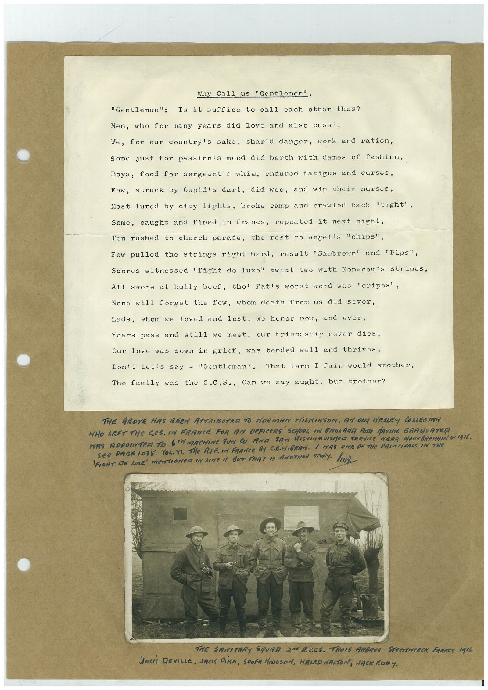

# Book 1 · scan 064

[Original scan](../../images/book-1/large/JPEG/BOOK1%20-%20065.jpg)

## Description

## Transcription

## Context

## Review notes

Compare the machine draft with the scan. Handwriting and names need human review.

## Artifacts

<!-- ARTIFACTS:START -->
Edit the artifacts field in this note’s frontmatter to change these records. This summary is generated.

### B01-S064-A01 — Letter, Photo & Handwritten note — Book 1, scan 064

Types: Typed document, Letter, Photo, Handwritten note

Scope: Whole scanned page; individual items can be split out during review.

Caption: Not mapped yet.

Caption source: Not recorded yet.

Caption status: unmapped
<!-- ARTIFACTS:END -->

## Machine transcription

<!-- OCR:START -->
Why Call us "Gentlemen".
"Gentlemen":
Is it suffice to call each other thus?
Men, who for many years did love and also cuss',
We, for our country's sake, sharld danger, work and ration,
Some just for passion's mood did berth with dames of fashion,
Boys, food for sergeant's whim, endured fatigue and curses,
Few, struck by Cupid's dart, did woo, and win their nurses,
Most lured by city lights, broke camp and crawled back "tight",
Some, caught and fined in francs, repeated it next night,
Ten rushed to church parade, the rest to Angel's "chips",
Few pulled the strings right hard, result "Sambrown" and "Pips",
Scores witnessed "fight de luxe" twixt two with Non-com's stripes,
All swore at bully beef, tho! Pat's worst word was "cripes",
None will forget the few, whom death from us did sever,
Lads, whom we loved and lost, we honor now, and ever.
Years pass and still we meet, our friendshir never dies,
Cur love was sown in grief, was tended well and thrives,
Don't lotis say - "Gentleman". That term I fain would smother,
The family was the C.C.S., Can we say aught, but brother?
THE ABOVE HAS BEEN ATTRIBUTRA TO NORMAN HELSINSOr, AN ON WESLEY COLLEGIAN
WHO LEFT THE COS. IN FRANCE FOR AT OFFICERS
SCHOOL IN ENGARNA ANTA MAYING GRARVATED
WAS APPOINT TO GIN MACHINE qUR CO AND SAM DISTINGUISHeR SERVICE MEAR MORTBRENAIN DO 1918.
See PAGElOSS VOL. YI. THe ALF IN FRANCE BY CEMBERN. / HAS ONE OF THE PRINCIPRAS IN THE
FIGHT DE LUNE MENTIONeD IN MNe 11 BUT THAT IS ANOTHER STORY. HiZ
THE SRNITARY SQUAD 2 ARCS. TROIS ARBReS STeerweRCK FRAnce 19%
JOCK DEVILLE, JACI PIKE, GOOFA HODGSON, WANNO WALTON, JACK FaDY.
<!-- OCR:END -->
