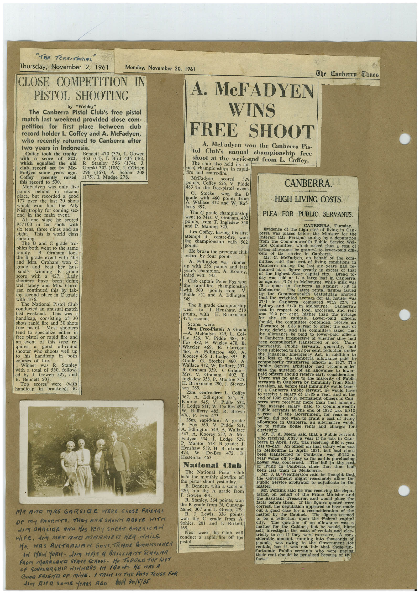

# Book 1 · scan 065

[Original scan](../../images/book-1/large/JPEG/BOOK1%20-%20066.jpg)

## Description

## Transcription

## Context

## Review notes

Compare the machine draft with the scan. Handwriting and names need human review.

## Artifacts

<!-- ARTIFACTS:START -->
Edit the artifacts field in this note’s frontmatter to change these records. This summary is generated.

### B01-S065-A01 — Newspaper clipping, Photo & Handwritten note — Book 1, scan 065

Types: Newspaper clipping, Photo, Handwritten note

Scope: Whole scanned page; individual items can be split out during review.

Caption: Not mapped yet.

Caption source: Not recorded yet.

Caption status: unmapped
<!-- ARTIFACTS:END -->

## Machine transcription

<!-- OCR:START -->
"THE TERRITORUAL"
Thursday, November 2, 1961
Monday, November 20, 1961
CLOSE COMPETITION IN
PISTOL SHOOTING
by "Webley"
The Canberra Pistol Club's free pistol
match last weekend provided close com-
petition for first place between club
record holder L. Coffey and A. McFadyen,
who recently returned to Canberra after
two years in Indonesia.
Coffey took the trophy
with
of
522,
Bennett 470 (37), J. Gowen
a
score
463 (64), I.
which
equalled
the
old
R.
Bird
435
Stanley
356 (174),
Mc-
+),4%)
club record set by
Gorski 302 (186), J. O'Brien
Fadyen some years ago.
Coffey
recently
this record to 530.
raised
296 (167),
A.
Schier
208
(175), I. Mudge 278.
McFadyen was only five
points
behind
second
place, but recorded a gooc
177 over the last 20 shots
which won him the
Ally
Nish trophy for coming sec-
ond in the main
event.
At one
stage
he
scored
95/100 in ten shots
six tens,
with
eight.
three nines and an
This is world class
sh he B and C grade tro-
The
phies both went to the same
family.
Graham
took
the B
grade event with 403
and Mrs.
Graham
won
grade and beat
her hus-
band's
winning
score with a
grade
427.
shooters have
Lady
been doing
well lately and Mrs. Corri-
gan continued this by
tak-
ing second place in C grade
with 376.
The National Pistol Club
conducted an unusual match
last
weekend.
This was
handicap,
consisting
of 30
shots rapid fire and 30 shots
free
pistol.
Most shooters
tend to
specialize either in
free pistol or rapid fire and
an
event of this type re-
quires
a
good
all-round
shooter who shoots well up
to his handicap in both
courses of tire.
Winner
was
R.
Stanley
with a total of 530, follow-
ed by J.
Gowen 527, and
B.
Bennett 507.
Top
scores
were
(with
handicap in brackets): B.
The Canberra Dimes
MRAMTO MRE GARSICE WERE CLOSE FRiENOS
OF MY PARENTS. THAY ARE SHOWN ABOYE WITH
LEM BARSIGE ANA HOS VERY SWEET AMERICAN
WIFE. dIM MEY ANO MARRIEA HER AMiLE
HE WAS AUSTRAMAN GOVT. TRAME GmaIsSIeNER
IN NEW YORK. dIM HAS A BRIGAIANT SCHOLAR
FROM MORFELANE STATE SCHOOL• He TODORA THe WST
OF GONOLRRSHIR WINNERS IN 1904 HE HAS A
GOOa FRIÉNA OF MiNE. I TRAN IN THE PAST TeNSE FOR
dem Aiea somé Venes R6o
$w/₴ 30/5/65
A. MeFADYEN
WINS
FREE SHOOT
A. MeFadyen won the Canberra Pis-
tol Club's annual championship free
shoot at the week-end from L. Coffey.
The club also held its an-
nual championships in rapid-
fire and centre-fire.
McFadyen
529
points, Coffey 526,
V. Pidde
483 in the free-pistol event.
CANBERRA.
Stocker
won
the
grade with 460
points
from
A. Wallace 412 and W
Raf-
HIGH LIVING COSTS.
ferty 397.
went to rade rapin hir
Graham, 402
PLEA FOR PUBLIC SERVANTS.
points, from T. Ingledew 358
and P. Manton 325
Les Coffey, having his first
attempt at
centre-lire,
won
the
championship with
points.
562
He broke the previous club
record by four points.
A. Edlington was runner-
up with 555
points and last
year's champion, A. Koorey,
third with 545.
Club captain Peter Fox woi
the
rapid-fire
championship
with 560
points trom
Pidde 551 and
A. Edlington
549
The B grade championship
went
Henshaw, 519
points, with
H. Brinkmann
474, second.
Scores
were:
50m. Free-Pistol: A Grade
-A.
fey
McFadyer
529. L.
Cof-
Pidde
483,
P.
470.
Wheeler
Corrigan
468,
460,
Koorey 435, J. Lodge 395
Grade-G.
Stocker
460
Wallace 412, W. Rafferty 397,
Graham 359.
C Grade-
Mrs.
V.
Graham
402,
Ingledew 358. P.
Manton 325,
H. Brinkmann 290, J. Steven-
son 269.
25m, centre-fire: L.
Coffey
562,
A.
Edlington 555,
Pidde
A
K.oOrg 511, W. Dedes 533,
Rafferty 485, R. Brown
476, P. Fox
473.
25m. rapid-fire: A grade
P.
Fox 560,
V. Pidde
551,
A. Edlington 549,
A. Wallace
547, А. Koorey 537, A. Мс-
Fadyen 534,
Lodge
529
Manton
518. B grade: J.
Henshaw 519, H. Brinkmann
474,
De-Bes
472,
Hesteman 463.
National Club
The National Pistol Club
held the monthly slowfire off
the pistol shoot yesterday.
B. Bennett, with a score of
420, Jon the A grade from
Gowen 401
R. Stanley, 364 points, wor
the B grade from N. Cunyng
name 3 Levis,
307 and J. Green, 279
336
points.
won the C grade from
A.
Sohier, 201 and J. Birkett,
169.
Next week the Club will
conduct a rapid fire off the
DISLOL.
CANBERRA
Tuesday
Evidence of the high cost of
living in
berra
was
placed before the Minister for the
Interior (Mr. Perkins) to-day by
a deputation
trom
the
Commonwealth Public
Service Wel-
fare Committee.
waen asked wat a cost or
Niving allowance be grante; to lower-naid offi-
cers
of
the
service
in
Canberra
Mr. C.
McFadyen.
com-
mittee, said that cost of living
conditions
in
Canberra
during
the
last six years had
mained at a
noure greauy mn
excess of that
of the highest State
capital city
Bread to-
day was
sold
1/
large loaf in Canberra
against /1.14 in Melbourne, while milk was
78 a
quart in
Canberra as
against
/5.8
in
Melbourne.
The latest
rental figures
by
the
Commonwealth statistician
issued
Showed
27/1 in Wanbeed, erne fo0 11 20 122/6
Canberra
compared
Sydney and 21/9 in
respect of food,
groceries
Canberra's
and rent
or 192 per cap.
higher
than the
ayclat
Cae oaNs.
officers,
should,
the committee contended,
receive
allowance
of E36 a year to offset the
cost of
living
deficit,
and the
conass ouee
askeehoar
allowance be paid to
lower-paid officers
in Canberra
irrespective
of whether
they
had
OCCE CONEOUSORSY
trasten ee non rotot
monwealth
Public
servants,
Com-
generally,
had
been subjected to a 22 per cent. reduction under
tualieia
uc ee cybot ataa0 es Belese
wee oss
OE NAA
Canberra allowance
paid to
compulsorily transferred officers in
1927.
The
Public
Service
arbitrator
niaa mecomem esoed
woau boe
ouesnoa
of an allowance
lower-
Paiete tar no gall eeive early consideraton.
was no gain to
the maiority
of Public
servants in Canberra. bv
immunity from State
taxation, as, before that immunity would bene-
fit a Canberra Public
servant, he would have
o recerve asa sy be avere sac sani
end of 1932 only 21 permanent officers in Can
Tee e syny mire
than that amount.
averare
baic to
Public servants at the end of 1932 Was
Colnnon teg.inn
£ 313
If the
Government, for reasons of
poliey, did not wish to grant a cost of living
allowance in Canberra, an alternative would
to
reduce house rents and charges for
electricity.
Mr. F. A. Meers said that a Public servant
who received €330 a year if he was
in Can-
erra in April, 1931, was receiving €90 a year
An officer on that salary who was
in Melbourne
in
April,
1931,
but hac
since
been
transferred to Canberra,
was 9122s
Deare oas concededs fare fai puree snt
power was
concerned
of living in
Canberra
since that time had
been less than
Mr. J. S. Weatherston said he thought that
the
Government might reasonably allow the
Public Service arbitrator to adjudicate in the
matter
Mr. Perkins said he
was receiving the depu-
and would place
tacts Defote t Tm. sur the ndures di pled ere
facts before them.
correo, une acpulauon apocarea co nave made
out a good case for a reconsideration
of the
matter
by
Cabinet.
figures seemed
reflection upon the Federal capital
city.
The question
of an allowance
matter for
was
the Cabinet, but he would, him-
self,
investigate the costs oi rentais and elec-
tricity to see if they were excessive.
A
con-
siderable
amount, running into thousands
of
30OS.
rențals,
the
Government for
but it was not fair that
those un-
fortunate
Public
servants
who
were
paying.
thetr rent should be penalised because of the
fact.
<!-- OCR:END -->
