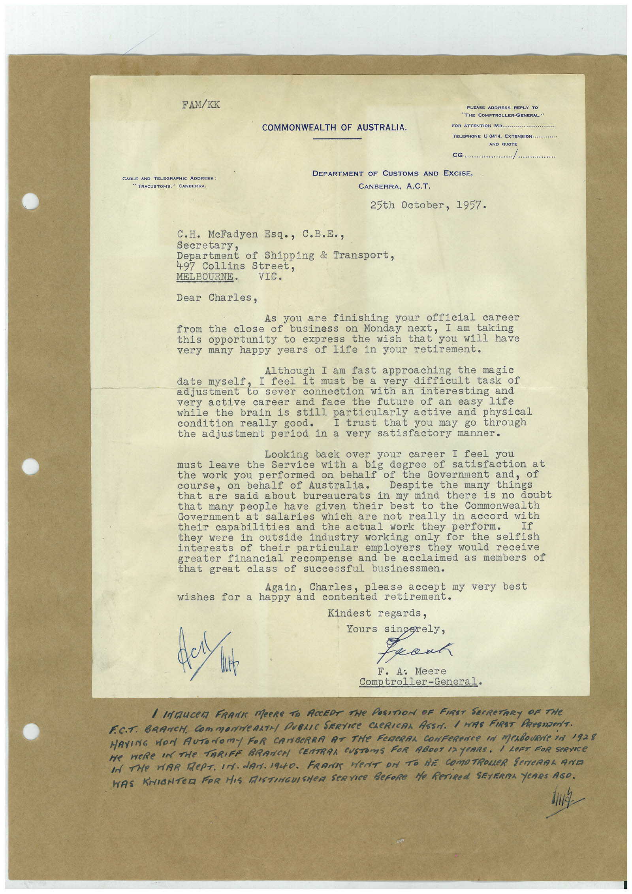

# Book 1 · scan 066

[Original scan](../../images/book-1/large/JPEG/BOOK1%20-%20067.jpg)

## Description

## Transcription

## Context

## Review notes

Compare the machine draft with the scan. Handwriting and names need human review.

## Artifacts

<!-- ARTIFACTS:START -->
Edit the artifacts field in this note’s frontmatter to change these records. This summary is generated.

### B01-S066-A01 — Letter & Handwritten note — Book 1, scan 066

Types: Typed document, Letter, Handwritten note

Scope: Whole scanned page; individual items can be split out during review.

Caption: Not mapped yet.

Caption source: Not recorded yet.

Caption status: unmapped
<!-- ARTIFACTS:END -->

## Machine transcription

<!-- OCR:START -->
FAM/KK
CABLE AND TELEGRAPHIC ADDRESS :
TRACUSTOMS," CANBERRA
PLEASE ADDRESS REPLY G
THE COMPTROLLER-GENERAL."
COMMONWEALTH OF AUSTRALIA.
FOR ATTENTON MR....
TELEPHONE U 0414 ExTENSION..
AND OBOTS
CG.
DEPARTMENT OF CUSTOMS AND EXCISE,
CANBERRA, A.C.T.
25th October, 1957.
C.H. McFadyen Esq., C.B.E.,
Secretary,
Department of Shipping & Transport,
497 Collins Street,
MEL BOURNE•
VIC.
Dear Charles,
you are finishing your official career
from the close of business on Monday next, I am taking
this opportunity to express the wish that you will have
very many happy years of life in your retirement.
Although I am fast approaching the magic
date myself
I feel it must be a very difficult task of
adjustment to sever connection with an interesting and
very active career and face the future of an easy life
while the brain is still particularly active and physical
condition really good.
I trust that you may go through
the adjustment period
in a very
satisfactory manner.
Looking back over
your career I feel you
leave the Service with a
big degree of satisfaction at
the work you performed on behalf of the Government and, of
course, on behalf of Australia.
Despite the many
that are said about bureaucrats in my mind there is no doubt
that
many people have given their best to the Commonwealth
Government at
salaries which
are not really in accord with
their capabilities and the actual work they perform.
they were
in outside industry working only for the
interests of their particular employers they would receive
greater financial
recompense and be acclaimed as members of
that great class of successful businessmen.
Again, Charles,
please
accept my very best
wishes
for a happy and contented retirement.
Kindest regards,
got wit
Yours sincerely,
kant
F. A: Meere
Comptroller-General.
/ INAUCer FRANK MeRe TO ACCEDE THe POSITION OF FIRST SeCReTARY OF THe
F.C.T. BRANCH. COmMONNeARTH PUBLIC SERVICe CLeRICAL ASSA. 1 HAS FIRST PResIDenT.
MAYING WON AUTONOmY FOR CANBeRRA AT THe FeReRAL CONFeReNCe IN MeABOURNe IN 1928
Be WERe IN THe TARIFF BRANCH CENTRAA CUSTOMS FOR ABOUT 12 YEARS. i LeFT FOR SeRVICe
IN THe WAR RePT. IN. dAN. 1940. FRAMES HerET Pr TO BE COMPTROLLeR SeNERAL AND
WAS KNIGNTER FOR HIS MISTINGUISHER SERVICE BeFORE He ReTIREd SEVERAL YeRRS AGO.
<!-- OCR:END -->
