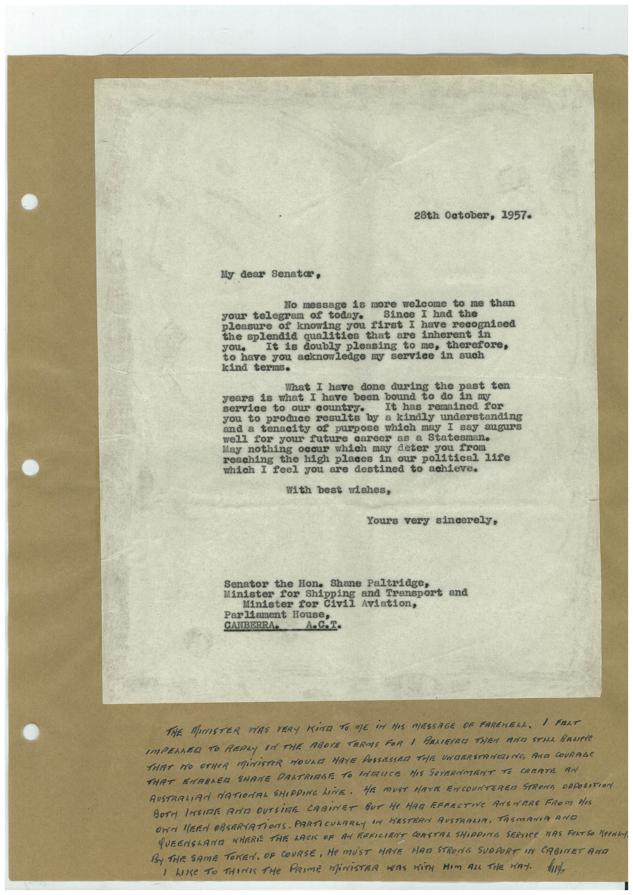

# Book 1 · scan 068

[Original scan](../../images/book-1/large/JPEG/BOOK1%20-%20069.jpg)

## Description

## Transcription

## Context

## Review notes

Compare the machine draft with the scan. Handwriting and names need human review.

## Artifacts

<!-- ARTIFACTS:START -->
Edit the artifacts field in this note’s frontmatter to change these records. This summary is generated.

### B01-S068-A01 — Letter & Handwritten note — Book 1, scan 068

Types: Typed document, Letter, Handwritten note

Scope: Whole scanned page; individual items can be split out during review.

Caption: Not mapped yet.

Caption source: Not recorded yet.

Caption status: unmapped
<!-- ARTIFACTS:END -->

## Machine transcription

<!-- OCR:START -->
28th October, 1957.
My dear Senatar,
No message is more welcome to me than
your telegram of today.
Since I had the
pleasure of knowing you first I have recognised
the splendid qualities that are inherent in
you•
It is doubly pleasing to me,
therefore,
to have you acknowledge my service
in such
kind terms.
What I have done during the past ten
years is what I have been bound to do in my
service to our country.
It has remained for
you to produce results by a kindly understanding
and a tenacity of purpose which may I say augurs
well for your future career as a Statesman.
May nothing occur which may deter you from
reaching the high places in our political life
which I feel you are destined to achieve.
With best wishes,
Yours very sincerely,
Senator the Hon. Shane Paltridge,
Minister for Shipping and Transport and
Minister for Civil Aviation,
Parliament House,
CANBERRA.
THE MINISTER WAS VERY KiNG TO ME iM HAS MESSAGE OF FAREHELL. I FRAT
IMPELLED TO REPLY IN THE ABOVE TERMS FOR I RELIEYED THEN AND STILL BRUPe
THAT NO OTHER MiNISTER WOULD HAVE POSSESSED THE UNDERSTRNEING AND COURAGE
THAT ENABLER SHAME PALTRIABE TO LATALICE HIS GOVERNMENT TO CREATE AN
AUSTRALIAN NATIONAL SHIPPING LINE. HE MUST HAVE ENCOUNTERER STRONG OBPOSSTION
BOTH INSIDE ANTA OUTSIRE CABINET BUT He MAR EFFECTIVE ANSWERS FROM HIS
OWN MERA OBSERVATIONS. PARTICULARLY IN HESTERN AUSTRALIA, TASMANIA ANO
QUEENSLANE NHERE THE LACK OF AN FEFICIENT CONSTRA SHIPPING SERVICE HAS FERTiSO "Penin
By THE SAME TOKEN, OF COURSE, He MUST HAVE HAR STRONG SUOPORT IN CABINET AND
I LOSE TO THINK THe PRIME MiNiSTER WAS WiTH HIm AlL THE WAY. hid
<!-- OCR:END -->
