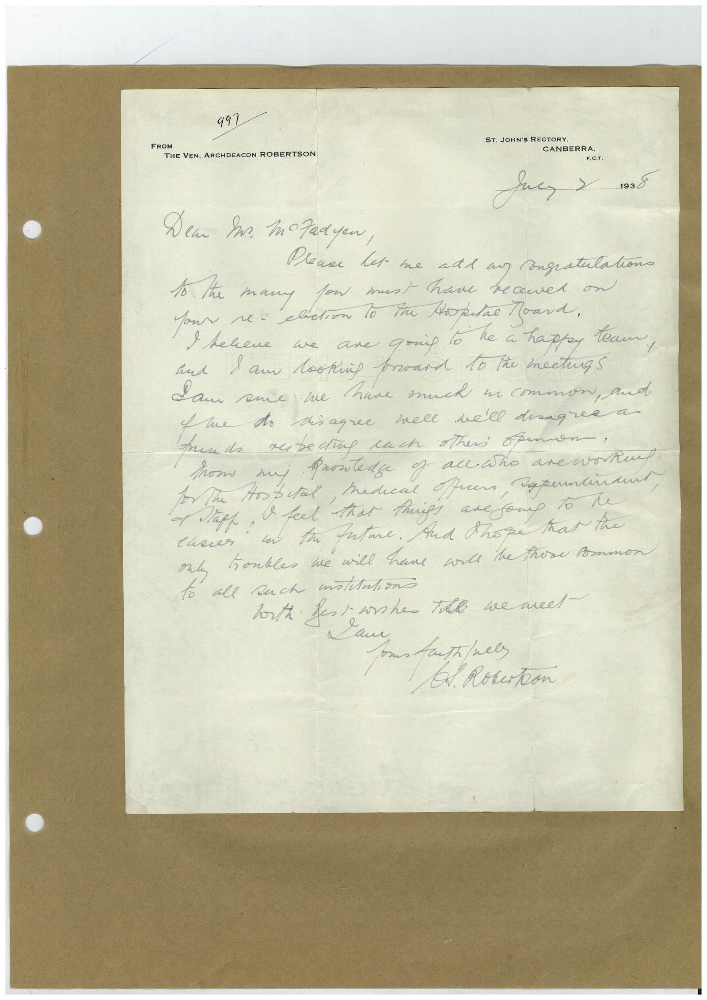

# Book 1 · scan 070

[Original scan](../../images/book-1/large/JPEG/BOOK1%20-%20071.jpg)

## Description

## Transcription

## Context

## Review notes

Compare the machine draft with the scan. Handwriting and names need human review.

## Artifacts

<!-- ARTIFACTS:START -->
Edit the artifacts field in this note’s frontmatter to change these records. This summary is generated.

### B01-S070-A01 — Letter — Book 1, scan 070

Types: Letter

Scope: Whole scanned page; individual items can be split out during review.

Caption: Not mapped yet.

Caption source: Not recorded yet.

Caption status: unmapped
<!-- ARTIFACTS:END -->

## Machine transcription

<!-- OCR:START -->
FROM
991
THE VEN. ARCHDEACON ROBERTSON
ST. JOHN'S RECTORY.
CANBERRA.
F.C.T.
1938
Dem In. mozadyen,
lena let me ade a Congratulation
I the many fow must have recened on
and 1 am lookip broard 10 the mectuas
Sam sue we have much in common, and
Yue to diagree well well dragree a
Aunds rebedug rach others opennon!
from
to The Hospital, Mediene offers,
→ Nape, I feel that Prigs are gong To te
an ta fatme. Aud Shore Kar tre
my honkles we will have ard the those Ammon
to all such milAntions
horth fess she the we meet -
Sau
C. Rokerton
<!-- OCR:END -->
