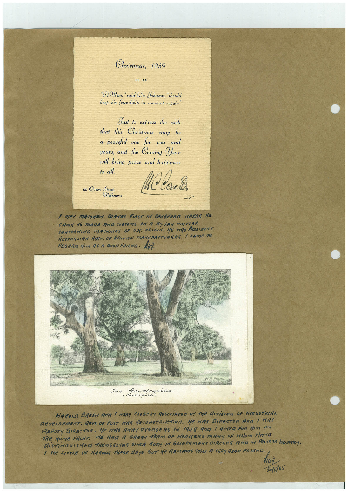

# Book 1 · scan 071

[Original scan](../../images/book-1/large/JPEG/BOOK1%20-%20072.jpg)

## Description

## Transcription

## Context

## Review notes

Compare the machine draft with the scan. Handwriting and names need human review.

## Artifacts

<!-- ARTIFACTS:START -->
Edit the artifacts field in this note’s frontmatter to change these records. This summary is generated.

### B01-S071-A01 — Letter & Handwritten note — Book 1, scan 071

Types: Typed document, Letter, Handwritten note

Scope: Whole scanned page; individual items can be split out during review.

Caption: Not mapped yet.

Caption source: Not recorded yet.

Caption status: unmapped
<!-- ARTIFACTS:END -->

## Machine transcription

<!-- OCR:START -->
Christmas,
1939
-H-
"A Man, " said Dr. Johnson, "shoul
feep his friendshit in constant repair
Just to express the wish
that this Christmas may be
a peaceful one for you and
yours, and the Coming Year
will bring peace and happiness
to all.
99 Queen Street,
Molbourne
I MET MATTHEN COATES FIRST IN CANBERRA WHERE HE
CAME TO TRARE AND CUSTOMS ON A BYLAN mATTER
CONCeRNING MACHINES OF UAL. ORIGIN. HE HAS PRESIDeNT
RUSTRAMIAN ASSN. OF BRITISH MANUFACTURERS. I CAMe TO
REGARIA Mom AS A GOOn FRIENA. HUt
Countryside
HARORA BREEN ANG I WERE CLOSELY ASSOCiATED IN THR DiViGION OF INGUSTRIAL
DEVELOPMENT. REPT. OF POST HAR RECONSTRUCTION. HE MAS DIRECTOR ANA / NAS
REPUTY DIRECTOR. He WAR ANAY OVERSERS A 1948 ARE / ACTEA FOR NIm ON
THE HOME FRONT. WE HAD A GREST TEAM OF HORKERS MANY OF WHOM MOVE
RiSTiNGUISHER THEMSELTES SINCE BOTT IN GOVERNMENT CIRCHAS AND IN PRIVATE HAUSTRY.
3015165
<!-- OCR:END -->
