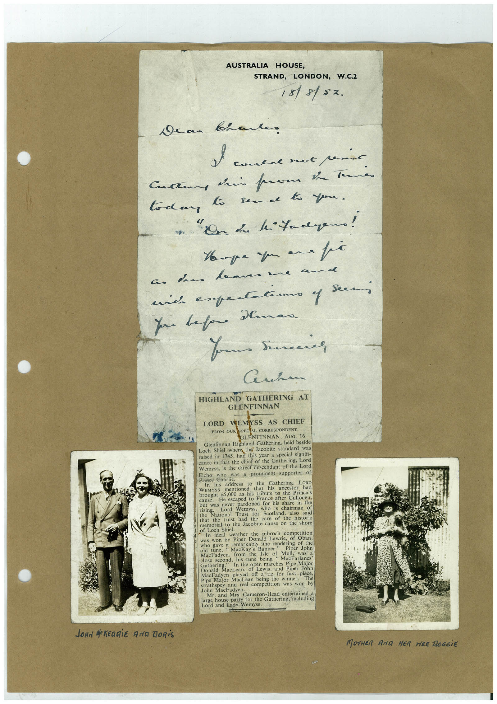

# Book 1 · scan 072

[Original scan](../../images/book-1/large/JPEG/BOOK1%20-%20073.jpg)

## Description

## Transcription

## Context

## Review notes

Compare the machine draft with the scan. Handwriting and names need human review.

## Artifacts

<!-- ARTIFACTS:START -->
Edit the artifacts field in this note’s frontmatter to change these records. This summary is generated.

### B01-S072-A01 — Photo, Newspaper clipping, Letter & Handwritten note — Book 1, scan 072

Types: Photo, Newspaper clipping, Letter, Handwritten note

Scope: Whole scanned page; individual items can be split out during review.

Caption: Not mapped yet.

Caption source: Not recorded yet.

Caption status: unmapped
<!-- ARTIFACTS:END -->

## Machine transcription

<!-- OCR:START -->
AUSTRALIA HOUSE,
STRAND, LONDON, W.C.2
18/8/52.
dear brante
I comes not senio
Culture iris pare be tenni
to dan
to sende to you.
Hope you an a fi
nich expertacono y
You before Demao.
Your serenes
Seem
HIGHLAND GATHERING AT
GLENFINNAN
LORD WEMYSS AS CHIEF
FROM OUR SPECIAL CORRESPONDENT
GLENFINNAN, AUG. 16
Glenfinnan Highland Gathering, held beside
Loch Shiel where the Jacobite standard was
raised in 1745, had this year a special signifi-
cance in that the chief of the Gathering, Lord
Wemyss, is the direct descendant of the Lord
Elcho who
was a prominent supporter of
Prinee
Charte.
In
his
address to the
Gathering, LoRD
brought
mentioned
that his
ancestor
had
€5.000 as his tribute to the Prince's
He escaped to France after Culloden,
but was never pardoned for his share in the
Wemyss
who
is chairman of
rise National Trust for Scotland,
also
said
that the
trust had the
care
ot the
historic
memorial to the Jacobite cause on the shore
of Loch Shiel.
In ideal weather
the
was won by Piper Donald Lawrie.
Pi Lavico of ban.
who gave a remarkably fine rendering of the
old
tune,
• MacKay's Banner
Piper John
from the Isle of Mull, was a
close second, his tune being
"MacFarlanes
Doned Mactath of Lewis, and Piper Joh
MacFadyen
played off a tie for hirst place
Pipe Major MacLean being the winner.
The
strathspey and reel competition was won by
John MacFadyen.
Mr.
and Mrs. Cameron-Head entertained a
for the Gathering, including
Lord and Lady Wemyss
JOHN dREDGiE ANG DORiS
MOTHER AND HER HEE HOGGiE
<!-- OCR:END -->
