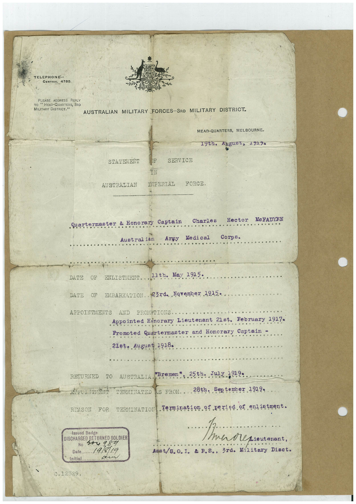

# Book 1 · scan 073

[Original scan](../../images/book-1/large/JPEG/BOOK1%20-%20074.jpg)

## Description

## Transcription

## Context

## Review notes

Compare the machine draft with the scan. Handwriting and names need human review.

## Artifacts

<!-- ARTIFACTS:START -->
Edit the artifacts field in this note’s frontmatter to change these records. This summary is generated.

### B01-S073-A01 — Typed document — Book 1, scan 073

Types: Typed document

Scope: Whole scanned page; individual items can be split out during review.

Caption: Not mapped yet.

Caption source: Not recorded yet.

Caption status: unmapped
<!-- ARTIFACTS:END -->

## Machine transcription

<!-- OCR:START -->
TELEPHONE-
CENTRAL 4780
PLEASE ADDRESS REPLY
TO " HEAD-QUARTERS, 3RD
MILITARY DISTRICT."
AUSTRALIAN MILITARY FORCES-3RD MILITARY DISTRICT.
HEAD-QUARTERS, MELBOURNE-
1900. 4уg48t, 192%
STATEMENT
AUSTRALIAN
SERVICE
IPERIAL
FORCE.
Quartermaster
& Honorary
Austral ian
Captain
Army
Charles
Me di cal
Hector
Me FADYEN
Corps.
DATE
OF
ENLISTMENT
21th. Hay 1915-
DATE
OF
EMBARKADION. R3rda Norember 1915•
APPOINTMENTS
AND PROMPTIONS.
Appointed Honorary Lieutenant 21st.
February 1917.
Promoted Quartermaster and Honorary Captain -
21st.
August 1918
RETURNED
TO
REASON
FOR
AUSTRALIA
*Bremen
. 25th.
JW 3919•
TERMINATED
IS FROM.
28th..
September
TERMINATION
termination of period of enlietnent.
Issued Badge
DISCHARGED RETURNED SOLDIEF
No
v54 984
Date..
19/8/19
Initial
0.12329.
Lieutenant,
Asst/8.0. I. & F.S., 3rd. Military Diact.
<!-- OCR:END -->
