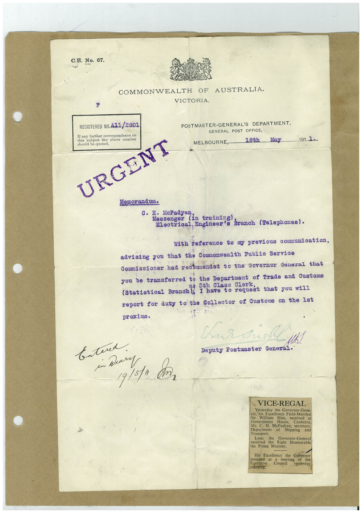

# Book 1 · scan 075

[Original scan](../../images/book-1/large/JPEG/BOOK1%20-%20076.jpg)

## Description

## Transcription

## Context

## Review notes

Compare the machine draft with the scan. Handwriting and names need human review.

## Artifacts

<!-- ARTIFACTS:START -->
Edit the artifacts field in this note’s frontmatter to change these records. This summary is generated.

### B01-S075-A01 — Typed document — Book 1, scan 075

Types: Typed document

Scope: Whole scanned page; individual items can be split out during review.

Caption: Not mapped yet.

Caption source: Not recorded yet.

Caption status: unmapped
<!-- ARTIFACTS:END -->

## Machine transcription

<!-- OCR:START -->
C.B. No. 67.
COMMONWEALTH OF AUSTRALIA.
VICTORIA.
REGISTERED NO. A11/2801
If any further correspondence on
this
subject the above number
should be quoted.
URGENT
POSTMASTER-GENERAL'S DEPARTMENT,
GENERAL POST OFFICE,
MELBOURNE, 18th
...May.
191. 1.
Memor and um.
c. H.
McFadyen
Messenger (In training branch (Telephones).
Electrical, Engineer's
with teterence tony previous communiestion,
advising you that the Commonwealth Public Service
Cormissioner had recormendea to the Governor General that
you be transferred to the Department of Trade and Customs
is 5th Class Clerl
Statistical Branch I have to request that vou wil
report for duty to the Collector of Customs on the 1st
proximo.
Char aust
- H!
Deputy Postmaster General.
Entered.
in Mary
19/5/a cân
VICE-REGAL
Yesterday the Governor-Gene-
ral, his Excellency Field-Marshal
Sir
William
Slim,
received
at
Government
House,
Canberra,
Mr. C. H. McFadyen, secretary
Department of
Shipping
and
Transport.
Later
the
Governor-General
received the Right Honourable
the Prime Minister.
His Excellency the Governor
presided at
meeting
Executive
Council
of the
(botning.
yesterday
<!-- OCR:END -->
