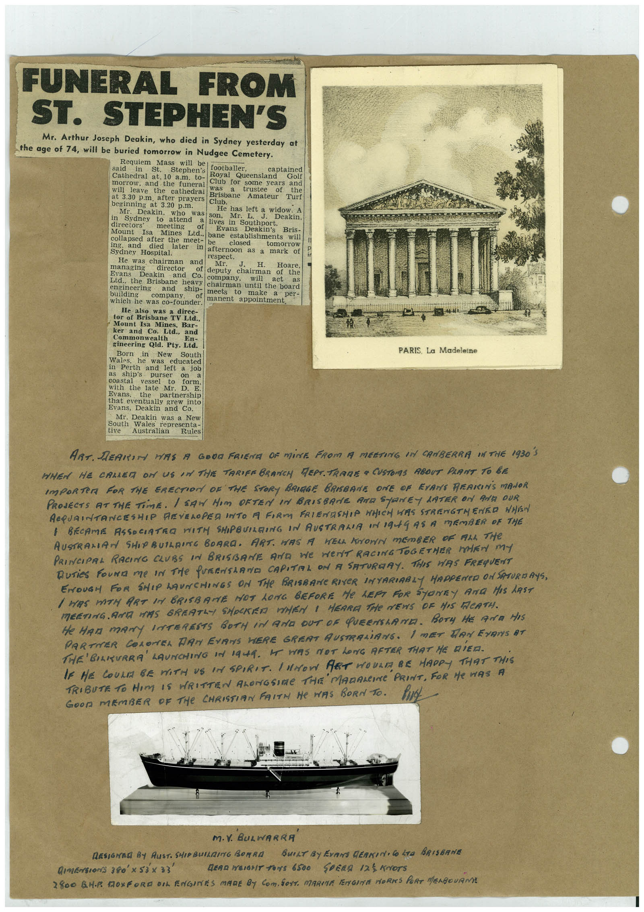

# Book 1 · scan 076

[Original scan](../../images/book-1/large/JPEG/BOOK1%20-%20077.jpg)

## Description

## Transcription

## Context

## Review notes

Compare the machine draft with the scan. Handwriting and names need human review.

## Artifacts

<!-- ARTIFACTS:START -->
Edit the artifacts field in this note’s frontmatter to change these records. This summary is generated.

### B01-S076-A01 — Newspaper clipping & Handwritten note — Book 1, scan 076

Types: Newspaper clipping, Handwritten note

Scope: Whole scanned page; individual items can be split out during review.

Caption: Not mapped yet.

Caption source: Not recorded yet.

Caption status: unmapped
<!-- ARTIFACTS:END -->

## Machine transcription

<!-- OCR:START -->
FUNERAL FROM
ST. STEPHEN'S
Mr. Arthur Joseph Deakin, who died in Sydney yesterday at
the age of 74, will be buried tomorrow in Nudgee Cemetery.
Requiem
said
in
Mass
will
be
St.
Stephen's
footballer,
captained
Cathedral at. 10 a.m. to-
Royal
Queensland
Golf
morrow, and the funeral
Club for
some years and
will
leave the cathedral
was
of
the
at 3.30 p.m.
after prayers
Brisbane
Amateur
Turf
beginning at 3.20 p.m.
Club.
Mr.
Deakin,
who
was
in
son.
Sydney
to
attend
He has left a wideakin.
directors'
Deakin,
lives
Mr.
in Southport.
Mount
Isa
muccumng
of
Evans
Mines
Ltd.. bane
Deakin's
Bris-
collapsed after the
establishments
will
meet-
ing. and
died
later
closed
Sydney Hospital.
afternoon
as
tomorrow
He was chairman and
respect.
mark
of
managing
MT.
J.
H.
director
Hoare,
Evans
Deakin
of deputy
and Co.
chairman
of the
Ltd. the Brisbane heavy
company.
will
act
as
engineering
building
and
ship-
chairman until the board
meets
company.
make
which he was co-founder.
of manent appointment.
per-
He also was a direc-
tor of Brisbane TV Ltd.,
Mount Isa Mines, Bar-
ker and Co. Ltd., and
Commonwealth
En-
gineering Qld. Pty. Ltd.
Born
in
New
South
Wales.
he was
educated
in Perth and left a job
as ship's
purser
coastal
vessel
to
on
form.
with the late Mr.
Evans.
the
38.
E.
partnership
that eventually grew into
Evans, Deakin and Co.
Mr. Deakin was a New
South Wales
tive
representa-
Australian
Rules
-144
PARIS. La Madeleine
ART. DEARIM HAS A GOOD FRIENE OF MiNE FROM A MEETING IN CANBERRA IN THE 1930 S
WHEN HE CALLER ON US IN THE TARIFE BRANCH REPT. TRADE a CUSTOMS RBOUT PLANT TO BE
IMPORTER FOR THE ERECTION OF THE STORY BRIAGE BRISBANE ONE OF EXANS REAIINS MANOR
PROJECTS AT THE TimE. I SAW HIM OFTEN IN BRISBANE AMR STONEY LATER ON ANA QUR
ACQUAINTANCESHIP REVELOPED INTO A FIRM FRIENDSHIP WHICH HIS STRENGTHENED WHEN
1 BECAME ASSOCIATRO WITH SHIPBUILRING IN AUSTRALIA IN 19AGAS A MEMBER OF THE
AUSTRALIAN SHOPBUILRIME BOARA. ART. WAS A WELL KNOWN MEMBER OF ALL THE
PRINCIPAL RACING CLUBS IN BRISBANE AND WE WeNT RACING TOGETHER MEN mY
Duries Four me In THe PURENSeRNE CAPITAL ON A SATURDAY. THIS HAS FREqUENT
ENOUGH FOR SHIP HAUNCHINGS ON THe BRISRANe RIVER INTARIRBLY HAPPENED ON SATURDAYS,
I MAS DATH ART IN BRISBANE HOT LONG BEFORE He LEFT FOR SYONTY AND HIS LAST
MEETING ANA HAS GREATLY SHOCKED WHEN I HEARE THe NEWS OF HIS FACATH.
He HAM mANY INTERESTS BOTH iN AND DUT OF QUEENSLAMA. BOTy HE AND HIS
PARTNER COLONEL DAN EVANS HERE GREAT AUSTRALiANS. I mET DAN EVAN'S AT
THE'BILKURRA LAUNCHING IN 1944. HE WAS MOT LONG AFTER THAT HE DIED.
MADANCINe PRINT, FOR He WAS A
GOOD MEMBER OF THe CHRISTIAN FAITH He HAS BORN TO.
M.Y. BULWARRA
RESIGNER BY RUST. SHIP BUILING BORRA BUILT BY EVANS GERKIN• Co LTO
BRISBANE
DIMEnsionS 380'x 53x 33'
GERR WEIGHT TONS 6500 SPEND 125 KNOTS
2800 BM. TOXFORD DIL ENGINES MARE BY COM, SOTT. MARITA FENGINE MORNS PORT MENGOURME
<!-- OCR:END -->
