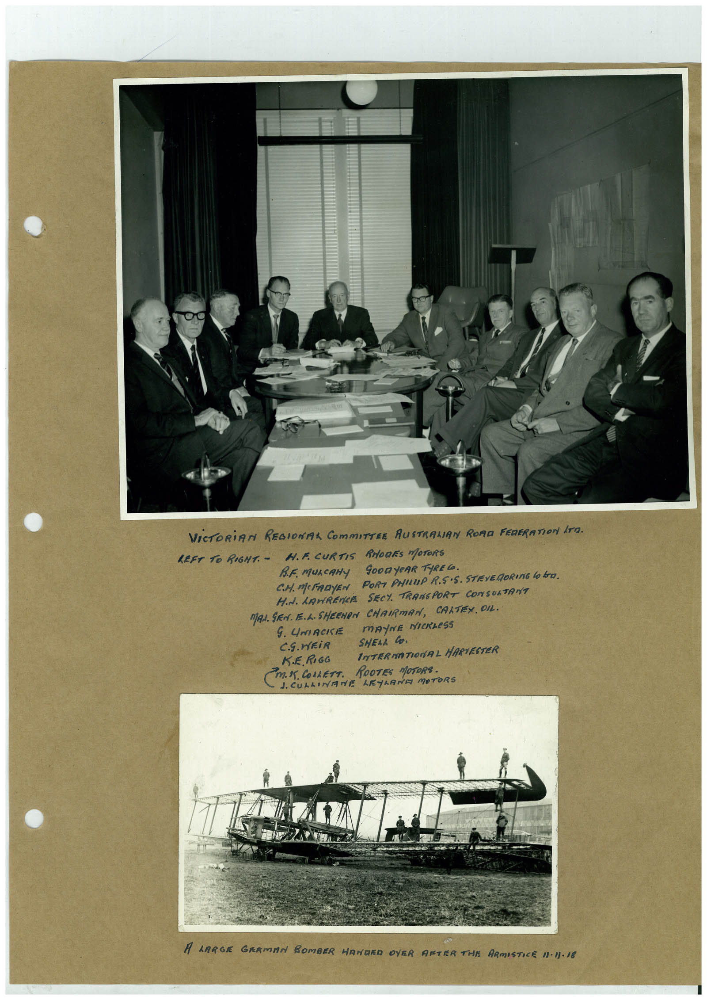

# Book 1 · scan 077

[Original scan](../../images/book-1/large/JPEG/BOOK1%20-%20078.jpg)

## Description

## Transcription

## Context

## Review notes

Compare the machine draft with the scan. Handwriting and names need human review.

## Artifacts

<!-- ARTIFACTS:START -->
Edit the artifacts field in this note’s frontmatter to change these records. This summary is generated.

### B01-S077-A01 — Photo & Handwritten note — Book 1, scan 077

Types: Photo, Handwritten note

Scope: Whole scanned page; individual items can be split out during review.

Caption: Not mapped yet.

Caption source: Not recorded yet.

Caption status: unmapped
<!-- ARTIFACTS:END -->

## Machine transcription

<!-- OCR:START -->
VICTORiAN REGIONAL COmmITTEE AUSTRALIAN RORa FERERATION ITa.
LEFT TO RIGHT. -
H.F. CURTIS RHODES MOTORS
B.F. muscANy
9000 yeAR TyRECo.
C.M. MCPRDYEN PORT PHILLIP R.S•S. STEVERORING LO bra.
H.N. LAWRENCE SECY TRANSPORT CONSULTANT
MAN. SEN. E.L. SHEEHRN CHAIRMAN, CALTEX. OIL.
G. UMACKE
mAYNE NICKLeSS
C.S.WEiR
SHELL CO.
KE RIGG
INTERMATIONAL HARVESTER
M. IT. COLLETT.
ROOTES MOTORS.
1. CULLINANE LEYLANA MOTORS
A LARGE GERMAN BOMBER HANDED OVER AFTER THE ARMISTICE 1-I)-18
<!-- OCR:END -->
