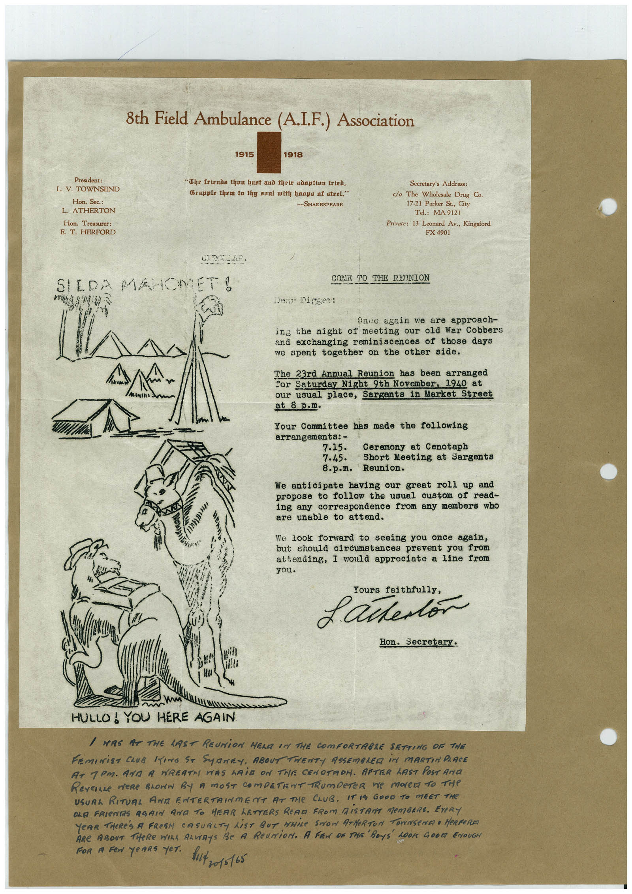

# Book 1 · scan 078

[Original scan](../../images/book-1/large/JPEG/BOOK1%20-%20079.jpg)

## Description

## Transcription

## Context

## Review notes

Compare the machine draft with the scan. Handwriting and names need human review.

## Artifacts

<!-- ARTIFACTS:START -->
Edit the artifacts field in this note’s frontmatter to change these records. This summary is generated.

### B01-S078-A01 — Certificate & Handwritten note — Book 1, scan 078

Types: Certificate, Handwritten note

Scope: Whole scanned page; individual items can be split out during review.

Caption: Not mapped yet.

Caption source: Not recorded yet.

Caption status: unmapped
<!-- ARTIFACTS:END -->

## Machine transcription

<!-- OCR:START -->
President:
L. V. TOWNSEND
Hon. Sec.:
L. ATHERTON
Hon. Treasurer:
E. T. HERFORD
8th Field Ambulance (A.I.F.) Association
1915
1918
"The friends thau bast and their adoption tried.
Crapple them to thy saul with hoops of steel."
-SHAKESPEARE
Secretary's Address:
c/o The Wholesale Drug Co.
17-21 Parker St., City
Tel.: MA 9121
Private: 13 Leonard Av., Kingsford
FX 4901
SILDA MAROMET!
219
COME TO THE RETINION
Dest Digger:
Once again we are approach-
ing the night of meeting
our old War Cobbers
and exchanging reminiscences of those days
we spent together on the other side.
The 23rd Annual Reunion has been arranged
Cor Saturday Night 9th November, 1940 at
our usual place, Sargants in Market Street
at 8 p.m.
Your Committee has made the following
arrangements: -
7.15.
Ceremony at Cenotaph
7.45.
Short Meeting at Sargents
8.p.m.
Reunion.
We anticipate having our great roll up and
propose to follow the usual custom of read-
ing any correspondence from any members who
are unable to attend.
We look forward to seeing you once again,
but should circumstances prevent you from
attending, I would appreciate a line from
you.
Yours faithfully,
£ artertor
Hon. Secretary.
HULLO! YOU HERE AGAIN
/ MRS AT THE LAST REUNiON HELA IN THE COmFORTABLE SETTING OF THE
FEmINiST CLUB KING ST SyNEY, ABOUT TWENTY ASSEMBLEG iN MARTIN PLACE
AT 1PM. ARA A NREAT PAS MAiD ON THE CENOTAOH. AFTER LAST POST ArIa
REVEILLE MeRe BLOWN By A MOST COmPETENT TRumpeTER ne mOLe TO THe
USUAL RITUAL ANA ENTERTAIMENT AT THE CLUB. IT IS GOOD TO MEET THE
OLE FRIENTS AGAIN AND TO HEAR LETTERS READ FROM DiSTANT MEMBERS. EVeRY
YeAR THeRE's A FRESN CASUALTY LiST BUT MHiLE STOW ATMeRTON TOWNSENET • HeRReRA
ARE ABOUT THeRE WILA ALViAYS Be A ReUNiON. A FEN OR THE BOYS 100K 60017 ENOUGH
FOR A FeN YeARS YeT.
but zo1s165
<!-- OCR:END -->
