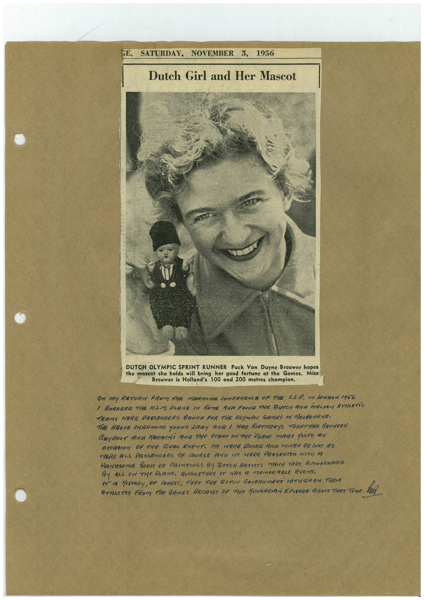

# Book 1 · scan 079

[Original scan](../../images/book-1/large/JPEG/BOOK1%20-%20080.jpg)

## Description

## Transcription

## Context

## Review notes

Compare the machine draft with the scan. Handwriting and names need human review.

## Artifacts

<!-- ARTIFACTS:START -->
Edit the artifacts field in this note’s frontmatter to change these records. This summary is generated.

### B01-S079-A01 — Newspaper clipping & Handwritten note — Book 1, scan 079

Types: Newspaper clipping, Handwritten note

Scope: Whole scanned page; individual items can be split out during review.

Caption: Not mapped yet.

Caption source: Not recorded yet.

Caption status: unmapped
<!-- ARTIFACTS:END -->

## Machine transcription

<!-- OCR:START -->
GE,
SATURDAY, NOVEMBER 3, 1956
Dutch Girl and Her Mascot
DUTCH OLYMPIC SPRINT RUNNER Puck Van Duyne Brouwer hopes
the mascot she holds will bring
her good fortune at the Games. Miss
Brouwer is Holland's 100 and 200 metres champion.
OR MY RETURN FROM THE MARITIME CONFERENCE OF THE 1.2.0. IN LONDON 1956
/ BOARDER THE KAM PRANE IN ROME ANA FOUNT THE BUTCH AND MALIAN ATHLETiC
TEAMS HERE PASSENGERS BOUTTA FOR THE OLYMOIC GAMES IN MEABOURNE-
THE ABOYE CHARMING YOUNG LARY AND 1 HAG BIRTHRAYS TOGETHER BETWEEN
BEyROUT ANa MARACHi ANA THe STAFF ON THe PARMe mARe qUITe AN
OCCASION OF THe DUAL EVENT. HE HERE DINED AND HINED DELUXE AS
HERE ALL PASSENGERS OF COURSE ANA He HERE PRESENTER WITH A
HArasome BOOK OF PRINTINGS BY RUTCH ARTISTS WHICH WeRe AUTOGRAPHeD
BY ALL ON THe PLANe. AATOGETHER IT HAS A MEmORABLE EVENT.
I IS HISTORY, OF COURSE, THRT THE RUTCH GOYERNMENT HITHOREW THER
ATHAETES FROM THe GAMES BECAUSe OF THe HUNGARIAN EPISORE ABOUT THAT Time.
<!-- OCR:END -->
