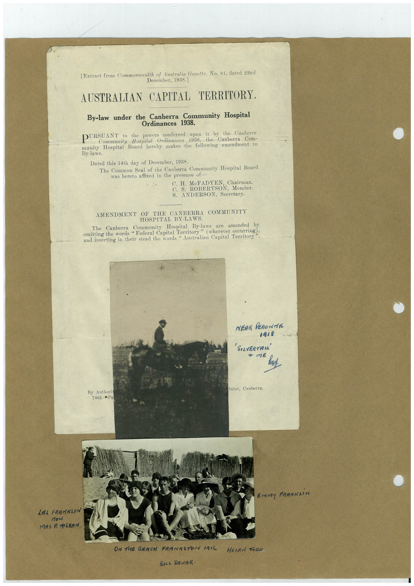

# Book 1 · scan 080

[Original scan](../../images/book-1/large/JPEG/BOOK1%20-%20081.jpg)

## Description

## Transcription

## Context

## Review notes

Compare the machine draft with the scan. Handwriting and names need human review.

## Artifacts

<!-- ARTIFACTS:START -->
Edit the artifacts field in this note’s frontmatter to change these records. This summary is generated.

### B01-S080-A01 — Letter, Photo & Handwritten note — Book 1, scan 080

Types: Typed document, Letter, Photo, Handwritten note

Scope: Whole scanned page; individual items can be split out during review.

Caption: Not mapped yet.

Caption source: Not recorded yet.

Caption status: unmapped
<!-- ARTIFACTS:END -->

## Machine transcription

<!-- OCR:START -->
[Extract from Commonwealth of Australia Gazette, No. 81, dated 22nd
December, 1938]
AUSTRALIAN CAPITAL TERRITORY.
By-law under the Canberra Community Hospital
Ordinances 1938.
PURSUANT to the powers conferred upon it by the Canberra
Community
Hospital Ordinances 1938,
the Canberra Com-
munity Hospital Board hereby makes
the following amendment to
By-laws.
Dated this 14th day of December, 1938.
The Common Seal of the Canberra Community Hospital Board
was hereto affixed in the presence of
C. H
McFADYEN, Chairman
C.
ROBERTSON, Member
S.
ANDERSON, Secretary.
AMENDMENT OF THE CANBERRA COMMUNITY
HOSPITAL BY-LAWS.
Community Hospital By-laws are amended by
omitting the words "Federai Capital Territory" (wherever occurine!?
and inserting in their stead the words " Australian Capital Territory
NEAR PERONTE
1918
'SOLVERTAN
• тє
inter, Canberra.
By Authori
7462.PR
Emmy FRANKLiN
LAL FRANKLIN
now
ON THE SEACH FRANKSTON 1916
BILL REWAR
<!-- OCR:END -->
