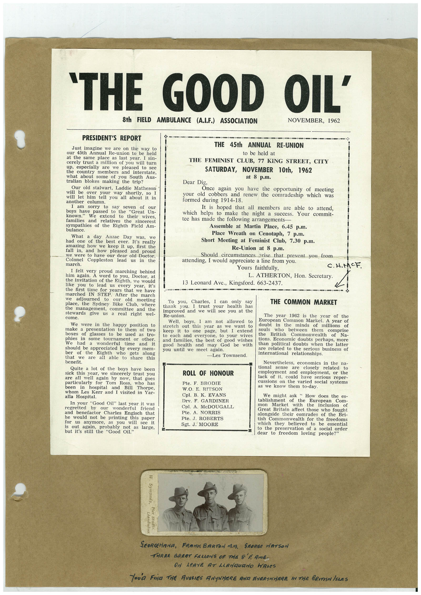

# Book 1 · scan 081

[Original scan](../../images/book-1/large/JPEG/BOOK1%20-%20082.jpg)

## Description

## Transcription

## Context

## Review notes

Compare the machine draft with the scan. Handwriting and names need human review.

## Artifacts

<!-- ARTIFACTS:START -->
Edit the artifacts field in this note’s frontmatter to change these records. This summary is generated.

### B01-S081-A01 — Newspaper clipping, Photo & Handwritten note — Book 1, scan 081

Types: Newspaper clipping, Photo, Handwritten note

Scope: Whole scanned page; individual items can be split out during review.

Caption: Not mapped yet.

Caption source: Not recorded yet.

Caption status: unmapped
<!-- ARTIFACTS:END -->

## Machine transcription

<!-- OCR:START -->
'THE GOOD OIL'
8th FIELD AMBULANCE (A.I.F.) ASSOCIATION
NOVEMBER, 1962
PRESIDENT'S REPORT
Just imagine we are on the
way to
our 45th Annual Re-union to be held
at the same place as last year.
I sin-
cerely trust a million of you will turn
up,
especially are we pleased to see
the county
members and interstate,
what about some of you
South Aus-
tralian blokes making the trip?
Our old stalwart, Laddie Matheson
will be over your
way shortly,
will let him tell you all about it in
another
am
sorry
to sav
seven of our
boys have
passed to the
"Great Un-
known."
We extend to their wives,
families
and
relatives
the
sincerest
sympathies of the
Eighth Field
Am-
bulance.
What a
day Anzac Day
was,
we
had one
of the best ever.
It's really
amazing how we keep it up, first the
tall in and
how pleased
and proud
we were to have our dear old Doetor,
Colonel
march.
Coppleston
lead
in
the
I felt very proud marching behind
him again.
A word to you,
Doctor, at
the invitation of the Eighth, we would
like
you
to lead us every
year, ins
the first time for
years that we have
marched IN STEP.
After the march
adjourned
meeting
place,
the
to
old
Sydney Bike Club, where
the management, committee
and the
stewards
right
wel-
THE 45th
ANNUAL RE-UNION
to be held at
THE FEMINIST CLUB, 77 KING STREET, CITY
SATURDAY, NOVEMBER 10th, 1962
Once again you have the opportunity of meeting
your old cobbers and renew the comradeship which was
members are able to attend,
which helps to
make the night a success. Your commit-
tee has made the following arrangements
Assemble at Martin Place, 6.45 p.m.
Place Wreath on Cenotaph, 7 p.m.
Short Meeting at Feminist Club, 7.30 p.m.
Should circumstances arise that prevent you from
attending, I would appreciate a line from you.
Yours faithfully,
L. ATHERTON, Hon. Secretary.
13 Leonard Ave., Kingsford. 663-2437.
C. H.MCF.
We were in the happy position to
make a presentation to them of two
boxes
phies
of
glasses to be used as tro-
In
some tournament or other.
We
a wonderful
time
and it
should be appreciated by every mem-
ber
of the
that
we
Eighth
who
gets
along
are
all
able to share this
To
you, Charles,
can
thank
only
say
I trust
your health
has
improved and we will
Re-union.
see you
the
Well
boys, I am
not
allowed
to
stretch
keep
out this year as we
want to
it
oute
page,
but I extend
to each and everyone, to your wives
and families,
the best of good wishes
good
health
and
may
God
you until we meet again.
be
with
-Les Townsend.
THE COMMON MARKET
The year
1962 is
the year of the
European Common Market.
A year of
doubt
in
the
minds
of
millions
of
souls
who
between
British
them
comprise
the
Commonwealth
of
Na-
tions. Economic doubts perhaps, more
than political doubts when the latter
are related to the serious business of
international relationships
Quite a lot of the boys have been
sick this year, we sincerely trust you
are
all well again by now, that goes
particularly for Tom Ross,
been in
hospital
and
who has
Bill
Thorpe,
whom Les Kerr and I visited in Yar-
alla Hospital.
In your "Good Oil" last year it was
regretted
and
our
wonderful
he
benefactor
friend
Charles Engisch that
would not be printing this paper
TOT
anymore,
as you
it
is
out
again,
will see
probably
not
but it's still the
Good Oil as large,
ROLL OF HONOUR
Pte. F. BRODIE
W.O. E. RITSON
Cpl. B. K. EVANS
Drv. F. GARDINER
Cpl. A. McDOUGALL
Pte. A. NORRIS
Pte. J. ROBERTS
Sgt. J. MOORE
Nevertheless, economics in the na-
tional
sense
are
closely
related
employment and employment,
or the
lack
of it, could have serious reper-
cussions on the varied social systems
as we know them to-day.
We might ask " How does the es-
tablishment
mon
of the
European
Com-
Market
with
the
inclusion
of
Great Britain affect those who fought
alongside their comrades of the Bri-
tish Commonwealth for the freedoms
which they believed to be
essential
to the preservation of a social order
dear to freedom loving people?"
W. Symonds,
Llanduano
Pier Studto.
SEORGEHANA,
FRAnK BARTON MiM.
SEORGe WATSON
THREE GREAT FELLONE OF THE S' AMB-
ON APAVE AT LANGUANO HALeS
Tova FIND THE RUSSIES ANYWHERE AND EVERYNNERE IN THE BRITISN ISLES
<!-- OCR:END -->
