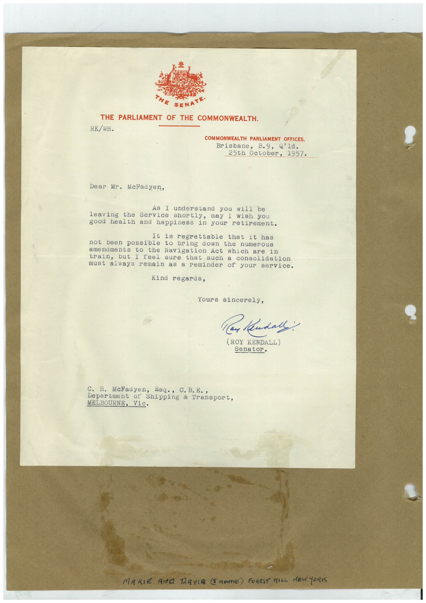

# Book 1 · scan 082

[Original scan](../../images/book-1/large/JPEG/BOOK1%20-%20083.jpg)

## Description

## Transcription

## Context

## Review notes

Compare the machine draft with the scan. Handwriting and names need human review.

## Artifacts

<!-- ARTIFACTS:START -->
Edit the artifacts field in this note’s frontmatter to change these records. This summary is generated.

### B01-S082-A01 — Letter & Handwritten note — Book 1, scan 082

Types: Typed document, Letter, Handwritten note

Scope: Whole scanned page; individual items can be split out during review.

Caption: Not mapped yet.

Caption source: Not recorded yet.

Caption status: unmapped
<!-- ARTIFACTS:END -->

## Machine transcription

<!-- OCR:START -->
SENATE•
THE PARLIAMENT OF THE COMMONWEALTH.
RK/WH.
COMMONWEALTH PARLIAMENT OFFICES,
Brisbane, B.9, Q'ld.
25th October, 1957.
Dear Mr. McFadyen,
As I understand you will be
leaving the Service shortly, may I wish you
good health
and happiness in your retirement.
It is regrettable that it has
not been possible
to
bring down the
numerous
amenaments to the Navigation Act which are
train, but I feel
sure
in
that such a consolidation
must always remain as a reminder of your service.
Kind regards,
Yours sincerely,
Claude:
(ROY KENDALL)
Senator.
C. H. McFadyen, Esq., C. B.E.,
Department of Shipping & Transport,
MELBOURNE, Vic.
MARIE ANG TAYIR (5 MONTHS) FOREST HILL NEWTORI
<!-- OCR:END -->
