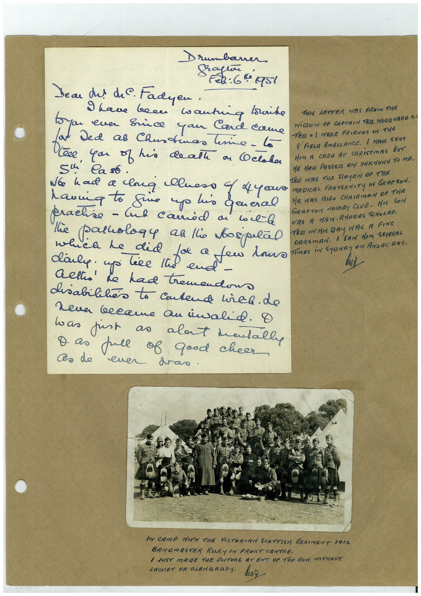

# Book 1 · scan 083

[Original scan](../../images/book-1/large/JPEG/BOOK1%20-%20084.jpg)

## Description

## Transcription

## Context

## Review notes

Compare the machine draft with the scan. Handwriting and names need human review.

## Artifacts

<!-- ARTIFACTS:START -->
Edit the artifacts field in this note’s frontmatter to change these records. This summary is generated.

### B01-S083-A01 — Letter, Photo & Handwritten note — Book 1, scan 083

Types: Letter, Photo, Handwritten note

Scope: Whole scanned page; individual items can be split out during review.

Caption: Not mapped yet.

Caption source: Not recorded yet.

Caption status: unmapped
<!-- ARTIFACTS:END -->

## Machine transcription

<!-- OCR:START -->
Drumbaner
2: 64951
Dear dul diC. Fadyen •
9 have been wantiq louike
THIS LETTER WAS FROM THE
WiROW OF CAPTAIN TER. WODQWARA 4
Ce you of his de all on COclaha
TER = / WERE FRIENES IN THE
8 FIELA AmBULANCE. / HAGI SENT
Sl Caso .
No had a long luess 4 dye
HOM A CARE AT CHRiSTmAS BUT
HE HAG PASSER ON UNKNONN TO MIE.
havia to fire up his general
ED WAS THE ROYEN OF THE
practice - Inh camid a vil-le
MEDICAL FRATERNITY IN GRAFTON.
HE VERS RISO CHAIRMAN OF THIS
GRAFTON dOCKEY CLUB. HIS SON
WAS A MAN. RHORES SCHOLAR.
TED IN HIS DAy WAS A FINe
OARSMAN. I SAM HIM
SEYERRI
TimES iN StarRy oN AndAc DAY.
he had tremendon
disabilities to Cutend hirel. do
neva became an invalid. O
was just as alant mentally
Das full of good cheer
As de euer das.
IM CAMP WITH THE VICTORIAN SCOTTISH REGIMENT 1912
BATAMASTER RILEY IN FRONT CENTRE.
I JUST MADE THE PICTURE AT EMS OF ToP RON WITHOUT
JACKET OR GLENGRARY. ANZ
<!-- OCR:END -->
