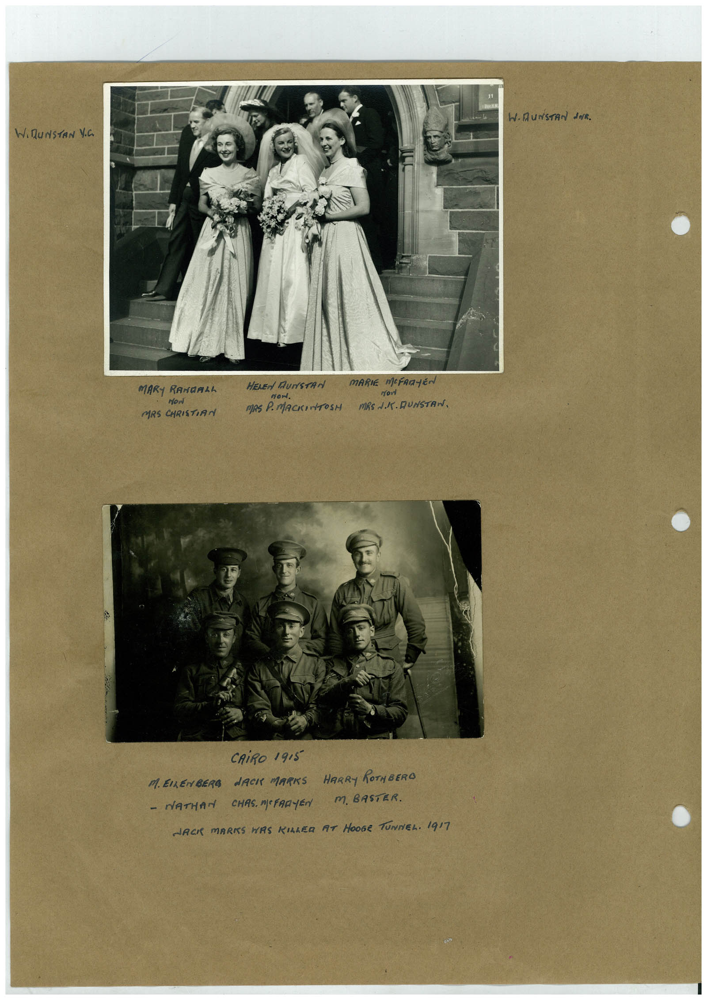

# Book 1 · scan 084

[Original scan](../../images/book-1/large/JPEG/BOOK1%20-%20085.jpg)

## Description

## Transcription

## Context

## Review notes

Compare the machine draft with the scan. Handwriting and names need human review.

## Artifacts

<!-- ARTIFACTS:START -->
Edit the artifacts field in this note’s frontmatter to change these records. This summary is generated.

### B01-S084-A01 — Photo & Handwritten note — Book 1, scan 084

Types: Photo, Handwritten note

Scope: Whole scanned page; individual items can be split out during review.

Caption: Not mapped yet.

Caption source: Not recorded yet.

Caption status: unmapped
<!-- ARTIFACTS:END -->

## Machine transcription

<!-- OCR:START -->
W.MUNSTAN derR.
WiRUNSTAN V.C.
MARY RANGRAh
How
MRS CHRISTIAN
nON.
MRS P. MACKINTOSH
MARIE MCFAR-EN
non
MRS J.K. RUNSTAN,
CAiRO 1915
M.ERLENBERO dACH MARRS HARRY ROTHBERO
- NATHAN CHAS. MPFADYEN M. BASTER.
ARCA MARKS WAS KILLER AT HOOGE TUNNEL. 1917
<!-- OCR:END -->
