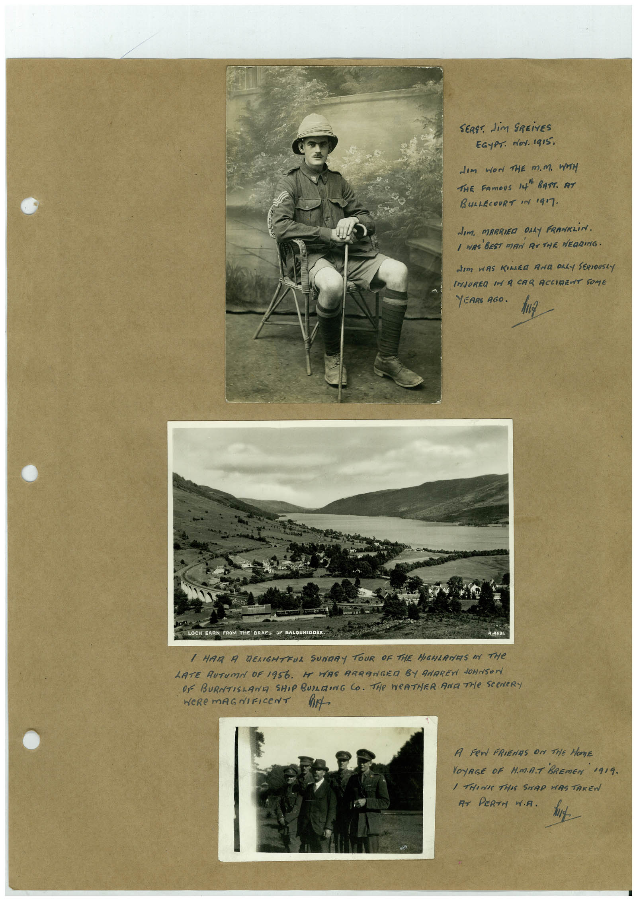

# Book 1 · scan 085

[Original scan](../../images/book-1/large/JPEG/BOOK1%20-%20086.jpg)

## Description

## Transcription

## Context

## Review notes

Compare the machine draft with the scan. Handwriting and names need human review.

## Artifacts

<!-- ARTIFACTS:START -->
Edit the artifacts field in this note’s frontmatter to change these records. This summary is generated.

### B01-S085-A01 — Photo & Handwritten note — Book 1, scan 085

Types: Photo, Handwritten note

Scope: Whole scanned page; individual items can be split out during review.

Caption: Not mapped yet.

Caption source: Not recorded yet.

Caption status: unmapped
<!-- ARTIFACTS:END -->

## Machine transcription

<!-- OCR:START -->
SERS" JiM SREivES
EGyPT. doy. Igi5.
Jem wor THE M.M. WH
THE FAmoUS 14" BATT. AT
BULLECOURT IN 1917.
dIm. MARRIED ONLY FRANKLiN.
1 WIRE BEST MAN RITHE NEGRING.
dim WAS KIALEG AND ONLY SERIOUSLY
INJURED IN A CAR ACCIRENT SOME
YEARS AGO.
OCH EARN FROM THE BRAES SP BALOUHIDDER
/ HAR A DENGHTRUL SUNDRY TOUR OF THE HIGHLANES IN THE
LATE AUTUMN OF 1956. HE HAS ARRANGED BY ANAREN dONNSON
OR BURTISLAND SHIP BUILEING CO. THe WeATHER AND THe SCeNeR
WeRe mAGNIFICeNT
A Fer FRIENDS ON THE HONE
VOYRGE OF H.MA.T BREmEN
1919.
/ THINKY THIS SNAP WAS TAKEN
AT PERTH W.A.
<!-- OCR:END -->
