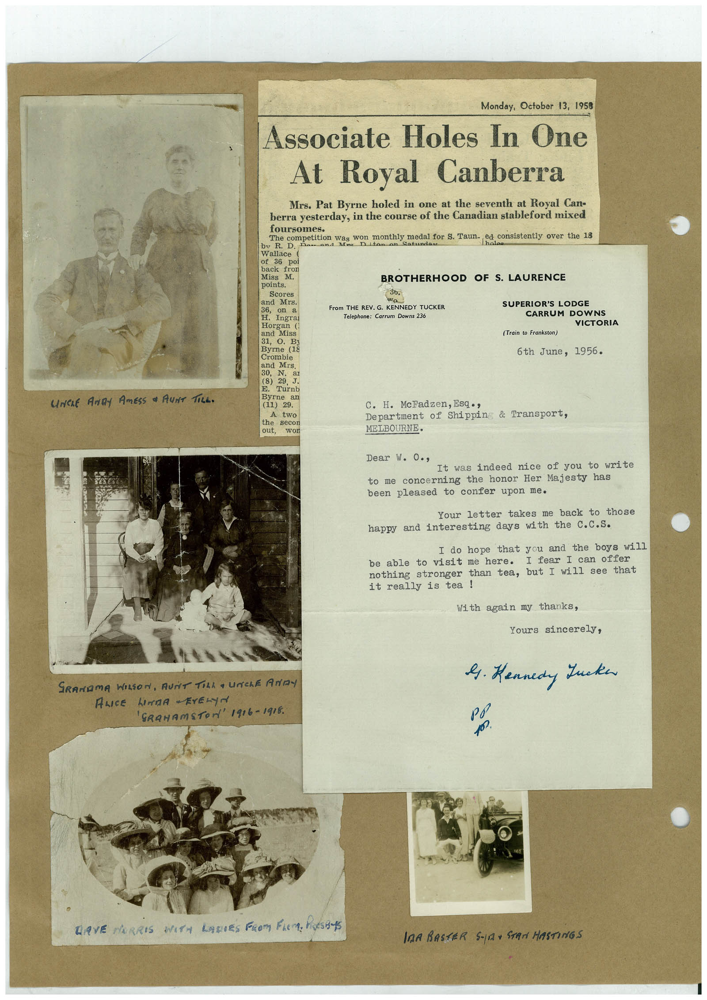

# Book 1 · scan 086

[Original scan](../../images/book-1/large/JPEG/BOOK1%20-%20087.jpg)

## Description

## Transcription

## Context

## Review notes

Compare the machine draft with the scan. Handwriting and names need human review.

## Artifacts

<!-- ARTIFACTS:START -->
Edit the artifacts field in this note’s frontmatter to change these records. This summary is generated.

### B01-S086-A01 — Newspaper clipping, Photo, Letter & Handwritten note — Book 1, scan 086

Types: Newspaper clipping, Photo, Letter, Handwritten note

Scope: Whole scanned page; individual items can be split out during review.

Caption: Not mapped yet.

Caption source: Not recorded yet.

Caption status: unmapped
<!-- ARTIFACTS:END -->

## Machine transcription

<!-- OCR:START -->
UNCLE ANDY AMESS • AUNT TiLL.
Monday, October 13, 1958
Associate Holes In One
At Royal Canberra
Mrs. Pat Byrne holed in one at the seventh at Royal Can-
berra yesterday, in the course of the Canadian stableford mixed
foursomes.
bv R. D.
The Competition Was on month medal for S. Taun. cd. co
ed consistently over the 18
Satundau
Wallace (
of 36
poi
back fron
Miss M.
BROTHERHOOD OF S. LAURENCE
points.
Scores
36,
From THE REV. G. KENNEDY TUCKER
Telephone: Carrum Downs 236
SUPERIOR'S LODGE
CARRUM DOWNS
VICTORIA
Horgan (
and Miss
31,
B3
Byrne (18
Crombie
and Mrs.
30,
N.
(8)
29
J.
Turnb
Byrne
an
(11)
29.
A
the
two
out,
(Train to Frankston)
6th June, 1956.
C. H. McFadzen, Esq • ,
Department of Shippin & Transport,
MELBOURNE.
Dear w. O.,
It was indeed nice of you to write
to me concerning the honor Her Majesty has
been pleased to confer upon me.
Your letter takes me back to those
happy and interesting days with the C.c.S.
I do hope that you and the boys will
be able to visit me here.
I fear I can offer
nothing stronger than tea, but I will see that
it really is tea!
With again my thanks,
Yours sincerely,
9. Kennedy Lucken
SRANDMA WILSON, AUNT TILL a UNChE ANDY
ALICE LINDA -ErELyN
'GRAHAmSTON' 1916-1918.
LAVE NORRIS WITH LADIES PROM FLEM. PASS
InA BASTER S-101 STAN HASTINGS
<!-- OCR:END -->
