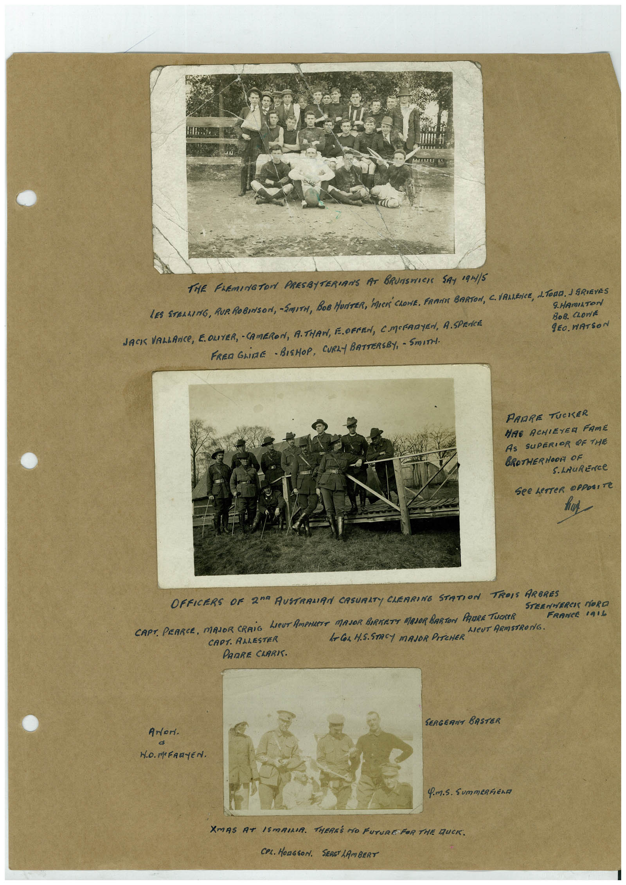

# Book 1 · scan 087

[Original scan](../../images/book-1/large/JPEG/BOOK1%20-%20088.jpg)

## Description

## Transcription

## Context

## Review notes

Compare the machine draft with the scan. Handwriting and names need human review.

## Artifacts

<!-- ARTIFACTS:START -->
Edit the artifacts field in this note’s frontmatter to change these records. This summary is generated.

### B01-S087-A01 — Photo & Handwritten note — Book 1, scan 087

Types: Photo, Handwritten note

Scope: Whole scanned page; individual items can be split out during review.

Caption: Not mapped yet.

Caption source: Not recorded yet.

Caption status: unmapped
<!-- ARTIFACTS:END -->

## Machine transcription

<!-- OCR:START -->
THE FAEMINGTON PRESBITERIANS AT BRUNSHICH SAY 19N1/5
LES STERLING, RUR ROBINSON, SMITH, BOB HUNTER, MUCK' CLONE, FRAMIE BARTON, C. VALENCE, L. TORO. I GRIEVES
9.HAmILTON
JACIS VALLANCE, E. OLIVER, - CAMERON, A.THAN, E.OFPEN, CMORARYEN, A.SPENCE
BoB. CLOn/t
gEO. WATSON
FREn GLINE - BISHOP, CURLY BATTERSBY, - SmITH.
PARRE TUCKER
HAE ACHIEYER FAME
AS SUPERIOR OF THE
BROTHERHOOR OF
S. LAuRENCe
See LeTTeR OPPOSITe
OFFICERS OF 20° AUSTRAMAN CASURITY CHERRING STATION TROIS ARBRES
STEENMERCI MORO
CAPT. PEARCE, MAJOR CRAIG LIEUT AMPHLETE MAJOR BIRKETT MAJOR BARTON PAURE TUCKER
FRANCE 101L
AlEUT ARMSTRONG.
CAPT. AALESTER
l-Cor H.S.STACY MAJOR PITCHER
PARRE CLARK.
ANor.
SERGERNT BASTER
Q.M.S. SummERFEno
XMAS AT ISMAILIA. THEREE NO FUTURE FOR THE DUCK.
COL. HONGSON. SERG LAmBERT
<!-- OCR:END -->
