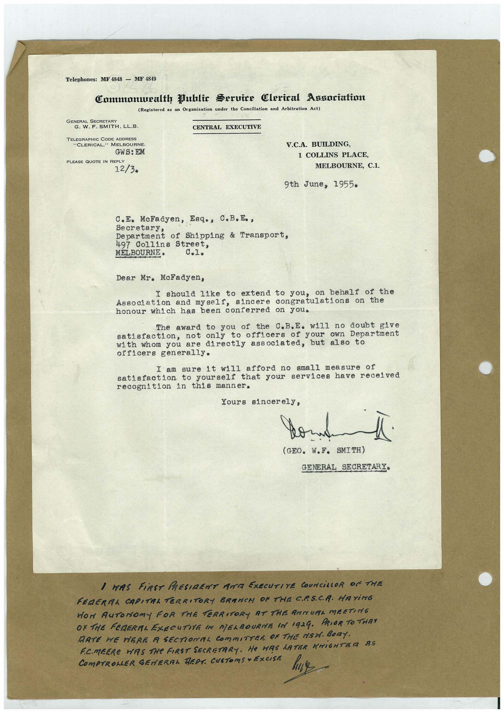

# Book 1 · scan 088

[Original scan](../../images/book-1/large/JPEG/BOOK1%20-%20089.jpg)

## Description

## Transcription

## Context

## Review notes

Compare the machine draft with the scan. Handwriting and names need human review.

## Artifacts

<!-- ARTIFACTS:START -->
Edit the artifacts field in this note’s frontmatter to change these records. This summary is generated.

### B01-S088-A01 — Letter & Handwritten note — Book 1, scan 088

Types: Typed document, Letter, Handwritten note

Scope: Whole scanned page; individual items can be split out during review.

Caption: Not mapped yet.

Caption source: Not recorded yet.

Caption status: unmapped
<!-- ARTIFACTS:END -->

## Machine transcription

<!-- OCR:START -->
Telephones: MF 4848 - MF 4849
Commonuealth Public Seruire Clerical Angoriation
(Registered as an Organisation under the Conciliation and Arbitration Act)
GENERAL SECRETARY
G. W. F. SMITH, LL.B.
CENTRAL EXECUTIVE
TELEGRAPHIC CODE ADDRESS
"CLERICAL," MELBOURNE.
GWS: EM
PLEASE QUOTE IN REPLY
12/3.
V.C.A. BUILDING,
1 COLLINS PLACE,
MELBOURNE, C.1.
9th June, 1955•
c.E. McFadyen, Esq., C.B.E.,
Secretary,
Department of Shipping & Transport,
497 Collins Street,
MELBOURNE•
Dear Mr. McFadyen,
I should like to extend to you,
on behalf of the
Association and myself, sincere
congratulations on the
honour which has been conferred on you.
The award to you of the C.B.E. will no doubt give
satisfaction, not only
to officers
your own Department
with whom you are
directly associated, but also to
officers generally.
I am sure it will afford no small measure of
satisfaction to yourself that your services have received
recognition in this manner.
Yours sincerely,
(GEO. W.F. SMITH)
GENERAL SECRETARY•
I WAS FiRST PRESIDENT ANT EXECUTIVE COUNCiLLOR OF THE
FEDERMA CAPITRA TERRITORY BRANCH OF THE CP.SCA. HATING
Wor AuToNomy FOR THE TERRITORY AT THE AMMURL MEETING
OR THE FERERAL EZECUTIVE IN MERBOURNE IN 1924. PRIOR TO THAT
DATE WE WERE A SECTIONAL COMMITTER OF THE MSH. BOnY.
F.C.MEERe WAS THe FIRST SECRETARY. He HAS LATER KNIGHTER AS
COmPTROLLER GENERAL REDS. CUSTOMS • EXCISE
<!-- OCR:END -->
