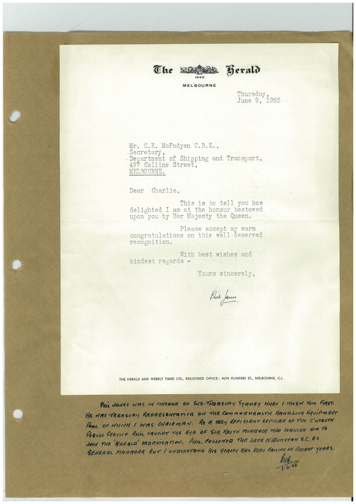

# Book 1 · scan 089

[Original scan](../../images/book-1/large/JPEG/BOOK1%20-%20090.jpg)

## Description

## Transcription

## Context

## Review notes

Compare the machine draft with the scan. Handwriting and names need human review.

## Artifacts

<!-- ARTIFACTS:START -->
Edit the artifacts field in this note’s frontmatter to change these records. This summary is generated.

### B01-S089-A01 — Letter & Handwritten note — Book 1, scan 089

Types: Typed document, Letter, Handwritten note

Scope: Whole scanned page; individual items can be split out during review.

Caption: Not mapped yet.

Caption source: Not recorded yet.

Caption status: unmapped
<!-- ARTIFACTS:END -->

## Machine transcription

<!-- OCR:START -->
The
Beraly
1840
MELBOURNE
'hursday;
June 9, 1955
Mr. C.E. McFadyen C.B.E.,
• Department of Shipping and Transport.
497 Collins Street,
MELBOURNE.
Dear Charlie,
This is to tell you how
delighted I am at the honour bestowed
upon you by Her Majesty the Queen.
lease accept my warn
congratulations on this well deserved
recognition.
With best wishes and
kindest regards -
Yours sincerely,
This one
THE HERALD AND
WEEKLY TIMES LTD., REGISTERED OFFICE: 44/74 FLINDERS ST., MELBOURNE, C.I.
PHIL NONES WIS IN CHARGE OF SUB.TRERSURY SYRNEY WHEN I SHEW HIM FIRST.
HE WAS TREASURY REPRESENTATiVE ON THE COMMORHERLTM HANDLING EQUiPMENT
POOL OF WHICH I HAS CHRIRMAN. AS A VERY EFFICIENT CFFiCER OF THE C'WeALTH
PUBLIC SERVICe PHiL CAUGHT THE EYE OF SIR KEITM MURIZOCH WHO INTRUCER HIM TO
JOIN THE HERALD OROANiSATION, PHIL. FOLLOWED THE hATRN.MUNSTAN V.C. AS
GENERAL MATMOER BUT / UNTERSTRAIA HIS HeRATH HAS BEEN FRILING OF RECENT YeRRS.
hIA
3.6.65
<!-- OCR:END -->
