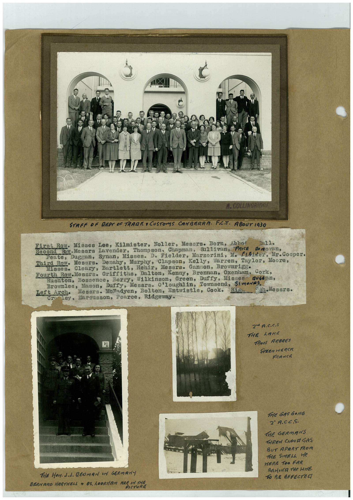

# Book 1 · scan 090

[Original scan](../../images/book-1/large/JPEG/BOOK1%20-%20091.jpg)

## Description

## Transcription

## Context

## Review notes

Compare the machine draft with the scan. Handwriting and names need human review.

## Artifacts

<!-- ARTIFACTS:START -->
Edit the artifacts field in this note’s frontmatter to change these records. This summary is generated.

### B01-S090-A01 — Newspaper clipping, Photo & Handwritten note — Book 1, scan 090

Types: Newspaper clipping, Photo, Handwritten note

Scope: Whole scanned page; individual items can be split out during review.

Caption: Not mapped yet.

Caption source: Not recorded yet.

Caption status: unmapped
<!-- ARTIFACTS:END -->

## Machine transcription

<!-- OCR:START -->
COLLINGRIDRE
STAFF OF REPT OF TRAGE • CUSTOMS CANBERRA. FCT. ABOUT 1930
First Row. Misses Lee, Kilmister, Noller, Mesers. Born, Abno
Bн11.
Second Eow.Messrs lavender, Thompson, Chapman,
Sullivan, PRICE
No no van,
Peate,
Duggan, Synan, Misses. D. Fielder, Marzorini, M. Flilder, Mr. Cooper.
Third Row. Messrs. Denahy, Murphy, Clapson, Kelly, Warren,
Taylor, Moore,
Misses. Cleary, Bartlett, Hehir, Messrs. Gannon, Brownrigg•
Fourth Row.Messrs. Griffiths, Dalton, Kenny, Brennan, Oxenham. Cork,
Rushton, Bossence, Berry, Wilkinson, Green, Duffy, Misses
Brownlee, Mason,
Duffy,
Mesars. O'loughlin,
Townsend, Simones.
Left Arch•
Mesers. Melodyen, Bolton, Entwistle, Cook.
"th Messrs.
CraTey, Marcusson, Pearce, Ridgeway.
2 A.C.C.S
THE LAKE
TROIs ARBRES
STEEN HERCK
FRANCE
The Horded. Bedman if
GERMANY
BERNARO HARTNELL • OS. LODRIAM ARE IN THE
PICTURE
THE GAS GONG
2° A.CC.S.
THE GERMANS
THREW CROUR GAS
BUT APART FROM
THE SMELL We
WERE TOO FAR
REMIER THe WHE
TO BE AFFECTEG
<!-- OCR:END -->
