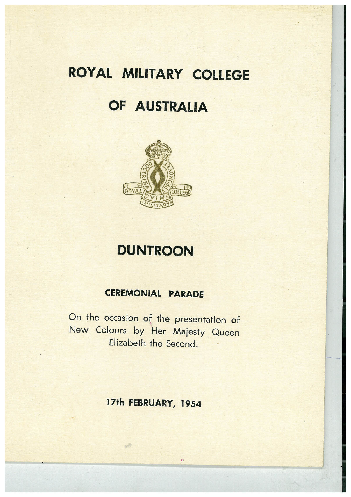

# Book 1 · scan 091

[Original scan](../../images/book-1/large/JPEG/BOOK1%20-%20092.jpg)

## Description

## Transcription

## Context

## Review notes

Compare the machine draft with the scan. Handwriting and names need human review.

## Artifacts

<!-- ARTIFACTS:START -->
Edit the artifacts field in this note’s frontmatter to change these records. This summary is generated.

### B01-S091-A01 — Printed material — Book 1, scan 091

Types: Printed material

Scope: Whole scanned page; individual items can be split out during review.

Caption: Not mapped yet.

Caption source: Not recorded yet.

Caption status: unmapped
<!-- ARTIFACTS:END -->

## Machine transcription

<!-- OCR:START -->
ROYAL MILITARY COLLEGE
OF AUSTRALIA
COLLEGER
DUNTROON
CEREMONIAL PARADE
On the occasion of the presentation of
New Colours by Her Majesty Queen
Elizabeth the Second.
17th FEBRUARY, 1954
<!-- OCR:END -->
