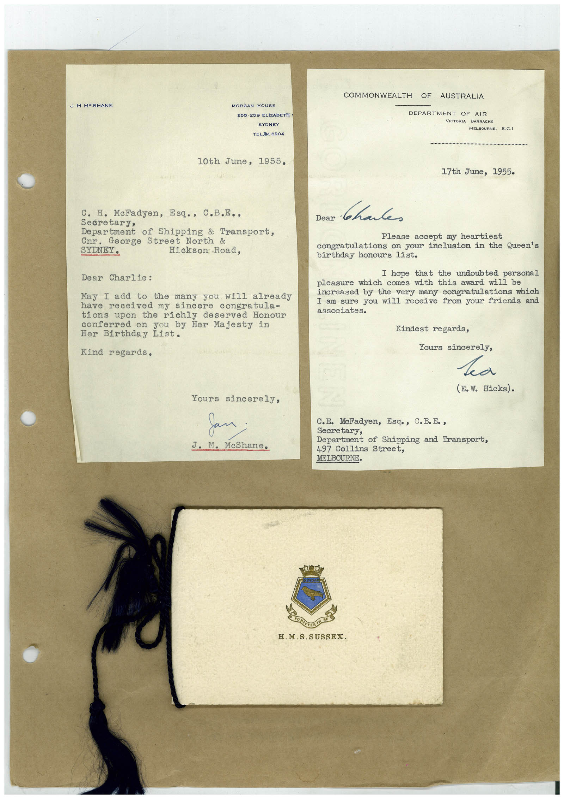

# Book 1 · scan 092

[Original scan](../../images/book-1/large/JPEG/BOOK1%20-%20093.jpg)

## Description

## Transcription

## Context

## Review notes

Compare the machine draft with the scan. Handwriting and names need human review.

## Artifacts

<!-- ARTIFACTS:START -->
Edit the artifacts field in this note’s frontmatter to change these records. This summary is generated.

### B01-S092-A01 — Letter & Invitation — Book 1, scan 092

Types: Typed document, Letter, Invitation

Scope: Whole scanned page; individual items can be split out during review.

Caption: Not mapped yet.

Caption source: Not recorded yet.

Caption status: unmapped
<!-- ARTIFACTS:END -->

## Machine transcription

<!-- OCR:START -->
UM M-SHANE
MORGAN HOUSE
255•259 ELIZABETH
SYDNEY
TELEM 6904
COMMONWEALTH
OF AUSTRALIA
DEPARTMENT OF AIR
VICTORIA
BARRACKS
MELBOURNE.
10th June, 1955.
17th June, 1955.
C. H. McFadyen, Esq., C.B.E.,
Secretary,
Department of Shipping & Transport,
Cnr. George Street North &
SYDNEY.
Hickson Road,
Dear Charlie:
May I add to the many you will already
have received my
sincere congratula-
tions upon the richly deserved Honour
conferred on you by Her Majesty in
Her Birthday List.
Kind regards.
Dear
Charles
Please accept my heartiest
congratulations on your inclusion in the Queen's
birthday honours list.
I hope that
the undoubted personal
pleasure which comes with
this award
will be
increased by the very many congratulations which
I am sure you will receive from your friends and
associates.
Kindest regards,
Yours sincerely,
ka
(E.W. Hicks).
Yours sincerely,
Jan
J. M. MoShane.
C.E. MoFadyen, Esq., C. B. Ee,
Secretary,
Department of Shipping and Transport,
497 Collins Street,
MELBOURNE.
FORTITER
H.M.S.SUSSEX.
<!-- OCR:END -->
