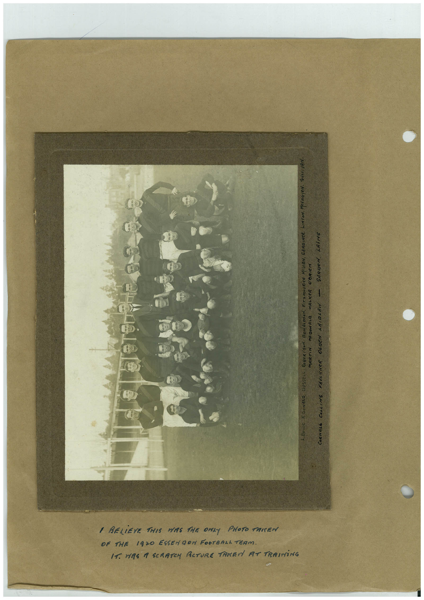

# Book 1 · scan 093

[Original scan](../../images/book-1/large/JPEG/BOOK1%20-%20094.jpg)

## Description

## Transcription

## Context

## Review notes

Compare the machine draft with the scan. Handwriting and names need human review.

## Artifacts

<!-- ARTIFACTS:START -->
Edit the artifacts field in this note’s frontmatter to change these records. This summary is generated.

### B01-S093-A01 — Photo & Handwritten note — Book 1, scan 093

Types: Photo, Handwritten note

Scope: Whole scanned page; individual items can be split out during review.

Caption: Not mapped yet.

Caption source: Not recorded yet.

Caption status: unmapped
<!-- ARTIFACTS:END -->

## Machine transcription

<!-- OCR:START -->
1 BOWe KDONALD. DUSSeLL ROgER/SON, DONALDSON, FITZMAURiCE MOLeAN, GARDINeR. LiNTon. MeFAoyer. SURRVAN
MARTiN MeDoNALd WALKeR OBRIen
I BELIEVE THIS WAS THE ONLY PHOTO TAKEN
OF THE 1920 ESSEN DOM FOOTBALL TEAM.
IT HASA SCRATCH ACTURE TAKEN AT TRAINiNG
CORNALL COLLiNS FAULKHeR OGDEN AALDLAW - GARDeN, LAiNG
<!-- OCR:END -->
