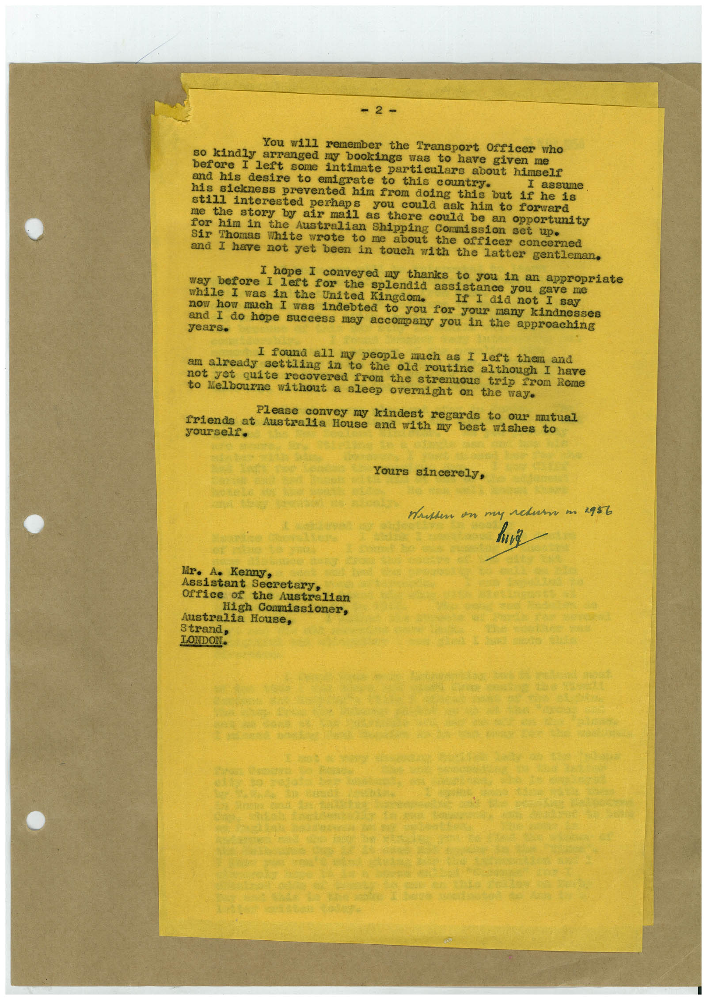

# Book 1 · scan 094

[Original scan](../../images/book-1/large/JPEG/BOOK1%20-%20095.jpg)

## Description

## Transcription

## Context

## Review notes

Compare the machine draft with the scan. Handwriting and names need human review.

## Artifacts

<!-- ARTIFACTS:START -->
Edit the artifacts field in this note’s frontmatter to change these records. This summary is generated.

### B01-S094-A01 — Letter — Book 1, scan 094

Types: Typed document, Letter

Scope: Whole scanned page; individual items can be split out during review.

Caption: Not mapped yet.

Caption source: Not recorded yet.

Caption status: unmapped
<!-- ARTIFACTS:END -->

## Machine transcription

<!-- OCR:START -->
= 2-
You will remember the Transport Officer who
so kindly arranged my bookings was to have given me
before I left some intimate particulars about himself
and his desire to emigrate to this country.
his sickness prevented him from doing this
but if he is
still interested perhaps you could ask him to forward
me the story by air mail as there could be an opportunity
for him in the Australian Shipping Cornission set up•
Sir Thomas White wrote to me about the officer concerned
and I have not yet been in touch with the latter gentleman.
I hope I conveyed my thanks to you in an appropriate
before I left for the splendid assistance you gave me
while I was in the United Kingdom.
If I did not I say
now how much I was indebted to you for your many kindnesses
and I do hope success may accompany you in the approaching
I found all my people much as I left them and
am already settling in to
the old routine although I have
not yet quite recovered from the strenuous trip from Rome
Melbourne without a sleep overnight on the way.
Please convey my kindest regards to our mutual
friends at Australia House and with my best wishes to
yourself.
Yours sincerely,
Mritten on my return m 2956
Mr. Ae Kenny,
Assistant Secretary,
Office of the Australian
High Cormissioner,
Australia House,
Strand,
LONDON.
<!-- OCR:END -->
