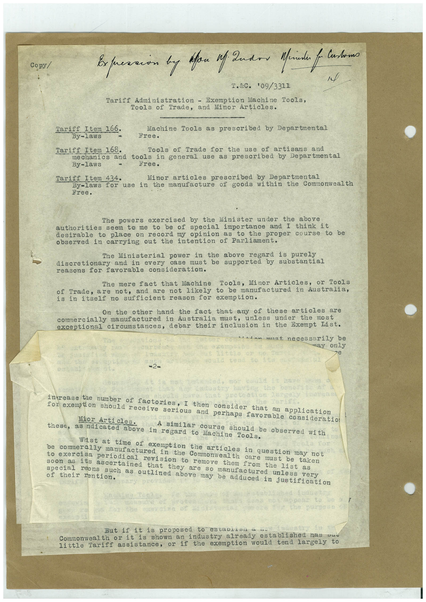

# Book 1 · scan 095

[Original scan](../../images/book-1/large/JPEG/BOOK1%20-%20096.jpg)

## Description

## Transcription

## Context

## Review notes

Compare the machine draft with the scan. Handwriting and names need human review.

## Artifacts

<!-- ARTIFACTS:START -->
Edit the artifacts field in this note’s frontmatter to change these records. This summary is generated.

### B01-S095-A01 — Typed document — Book 1, scan 095

Types: Typed document

Scope: Whole scanned page; individual items can be split out during review.

Caption: Not mapped yet.

Caption source: Not recorded yet.

Caption status: unmapped
<!-- ARTIFACTS:END -->

## Machine transcription

<!-- OCR:START -->
Copy/
Expression by fan if Indon Mride f
- Customa
T.&C. "09/3311
Tariff Administration - Exemption Machine Tools,
Tools of Trade, and Minor Articles.
Tariff Item 166.
Machine Tools as prescribed by Departmental
By-laws
Free.
Tariff Item 168.
Tools of Trade for the use of artisans and
mechanics and
tools in general use
as prescribed by Departmental
By -laws
Free.
Tariff Item 434.
Minor articles prescribed by Departmental
By-laws for use in
the manufacture of goods within the Commonwealth
The powers exercised by the Minister under the above
authorities seem to me to be of special importance
and I think it
desirable to place on record my opinion as to the proper course to be
observed in carrying out the intention of Parliament.
The Ministerial power in the above
regard is purely
discretionary and in every
case must be supported by
substantial
reasons for favorable consideration.
The mere fact that Machine Tools, Minor Articles, or Tools
of Trade, are not,
and are not likely to be
manufactured in
Australia,
is in itself no sufficient reason for exemption.
On the other hand the fact that any of these articles are
cormercially manufactured in Australia must, unless under
the most
exceptional circumstances, debar their inclusion in the Exempt list.
1imn must. necessarily be
may only
-2-
intrease the number of factories, I then consider that an application
for exemption should receive serious and perhaps favorable consideratio
Mior Articles.
A similar course should be observed with
these,
as ndicated above in regard to Machine Tools.
Whst at time of exemption the articles in question may not
be commerally manufactured in the Commonwealth care must be taken
to exercisa periodical revision to remove them from
the list as
soon as its ascertained
that they are so manufactured unless very
special reons such as outlined above may be adduced in justification
of their rention.
But if it is proposed to estauriou a "-
Commonwealth or it is shown an industry already established has vuu
little Tariff assistance, or if the exemption would tend largely to
<!-- OCR:END -->
