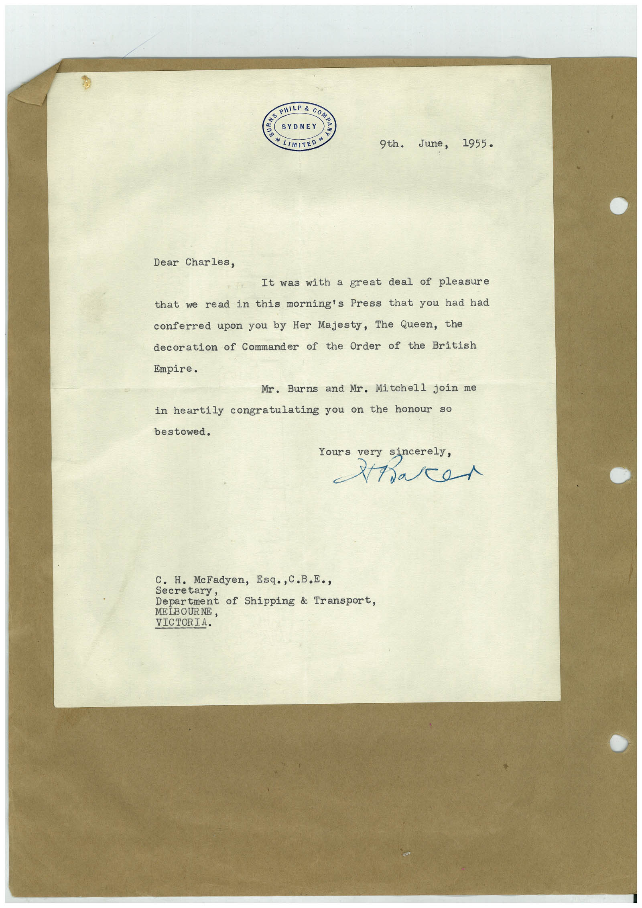

# Book 1 · scan 096

[Original scan](../../images/book-1/large/JPEG/BOOK1%20-%20097.jpg)

## Description

## Transcription

## Context

## Review notes

Compare the machine draft with the scan. Handwriting and names need human review.

## Artifacts

<!-- ARTIFACTS:START -->
Edit the artifacts field in this note’s frontmatter to change these records. This summary is generated.

### B01-S096-A01 — Letter — Book 1, scan 096

Types: Typed document, Letter

Scope: Whole scanned page; individual items can be split out during review.

Caption: Not mapped yet.

Caption source: Not recorded yet.

Caption status: unmapped
<!-- ARTIFACTS:END -->

## Machine transcription

<!-- OCR:START -->
AS PHILP & COME
SYDNEY
* LIM TEPH
9th.
June, 1955.
Dear Charles,
It was with a great deal of pleasure
that we read in this morning's Press that you had had
conferred upon you by Her Majesty, The Queen, the
decoration of Commander of the Order of the British
Empire.
Mr. Burns and Mr. Mitchell join me
in heartily congratulating you on the honour so
bestowed.
Yours very sincerely,
Hare
C. H. McFadyen, Esq., C.B.E.,
Secretary,
Department of Shipping & Transport,
MELBOURNE,
VICTORIA.
<!-- OCR:END -->
