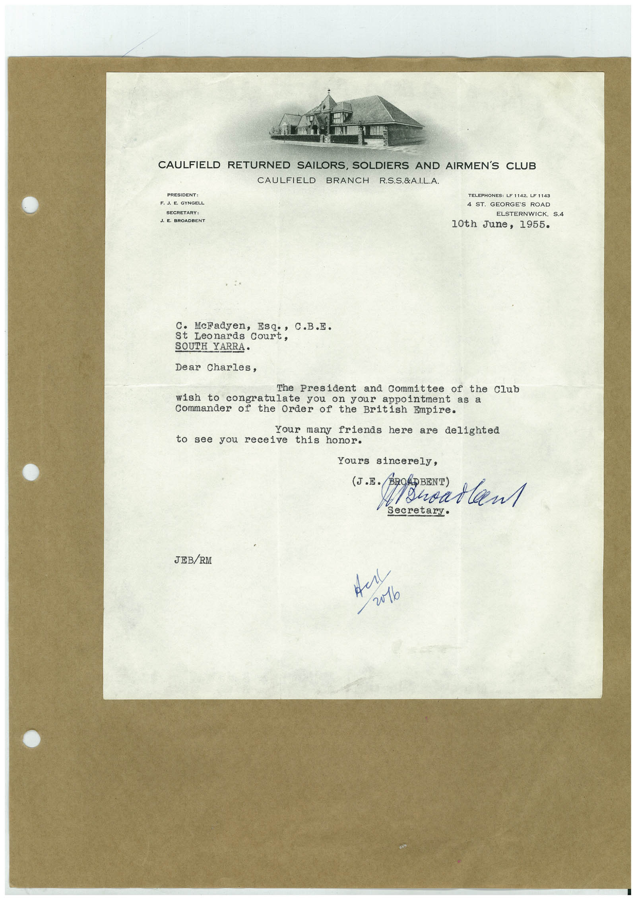

# Book 1 · scan 098

[Original scan](../../images/book-1/large/JPEG/BOOK1%20-%20099.jpg)

## Description

## Transcription

## Context

## Review notes

Compare the machine draft with the scan. Handwriting and names need human review.

## Artifacts

<!-- ARTIFACTS:START -->
Edit the artifacts field in this note’s frontmatter to change these records. This summary is generated.

### B01-S098-A01 — Letter — Book 1, scan 098

Types: Typed document, Letter

Scope: Whole scanned page; individual items can be split out during review.

Caption: Not mapped yet.

Caption source: Not recorded yet.

Caption status: unmapped
<!-- ARTIFACTS:END -->

## Machine transcription

<!-- OCR:START -->
CAULFIELD RETURNED SAILORS, SOLDIERS AND AIRMEN'S CLUB
CAULFIELD BRANCH R.S.S.&A.I.L.A.
PRESIDENT:
F. J. E. GYNGELL
SECREIANT:
J. E. BROADBENT
TELEPHONES: LF 1142, LF 1143
4 ST. GEORGE'S ROAD
ELSTERNWICK, S.4
10th June, 1955.
C• McFadyen,
Esq., C.B.E.
St Leonards Court,
SOUTH YARRA.
Dear Charles,
The President and Committee of the Club
wish to congratulate you on your appointment as a
Commander of the Order of the British Empire.
Your many friends here are delighted
to see you receive this honor.
Yours sincerely,
(J.E.
BOADBENT)
/ Shoarlan
Secretary•
JEB/RM
v0lo
<!-- OCR:END -->
