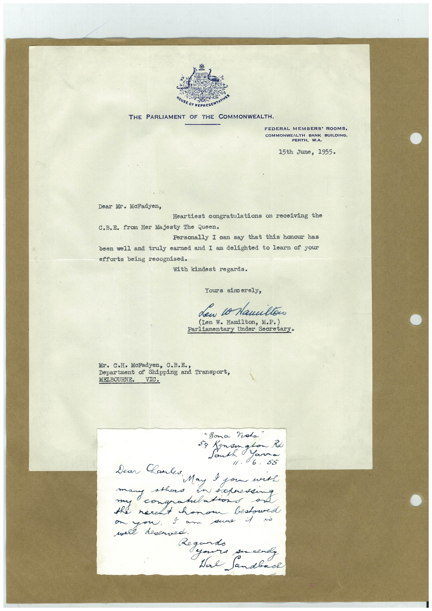

# Book 1 · scan 099

[Original scan](../../images/book-1/large/JPEG/BOOK1%20-%20100.jpg)

## Description

## Transcription

## Context

## Review notes

Compare the machine draft with the scan. Handwriting and names need human review.

## Artifacts

<!-- ARTIFACTS:START -->
Edit the artifacts field in this note’s frontmatter to change these records. This summary is generated.

### B01-S099-A01 — Letter & Handwritten note — Book 1, scan 099

Types: Typed document, Letter, Handwritten note

Scope: Whole scanned page; individual items can be split out during review.

Caption: Not mapped yet.

Caption source: Not recorded yet.

Caption status: unmapped
<!-- ARTIFACTS:END -->

## Machine transcription

<!-- OCR:START -->
MOUSE OF REPRESE
THE PARLIAMENT OF THE COMMONWEALTH.
FEDERAL MEMBERS' ROOMS,
COMMONWEALTH BANK BUILDING.
PERTH, W.A.
15th June, 1955.
Dear Mr. McFadyen,
Heartiest congratulations on receiving the
C.B.E. from Her Majesty The Queen.
Personally I can say that this honour has
been well and truly earned and I am delighted to learn of your
efforts being recognised.
With kindest regards.
Yours sincerely,
den o Namiltoo
(Len W. Hamilton, M.P.)
Parliamentary Under Secretary•
Mr. C.H. McFadyen, C.B.E.,
Department of Shipping and Transport,
MELBOURNE.
VIC.
"Bona Vota"
59 mangland
/1. 6. 53
many athers
in expressing
congratulations
the necent honor bestowed
were dese
Tam sure i
• deserved.
Regard.
yours
ser clady
Ware Sandbach
<!-- OCR:END -->
