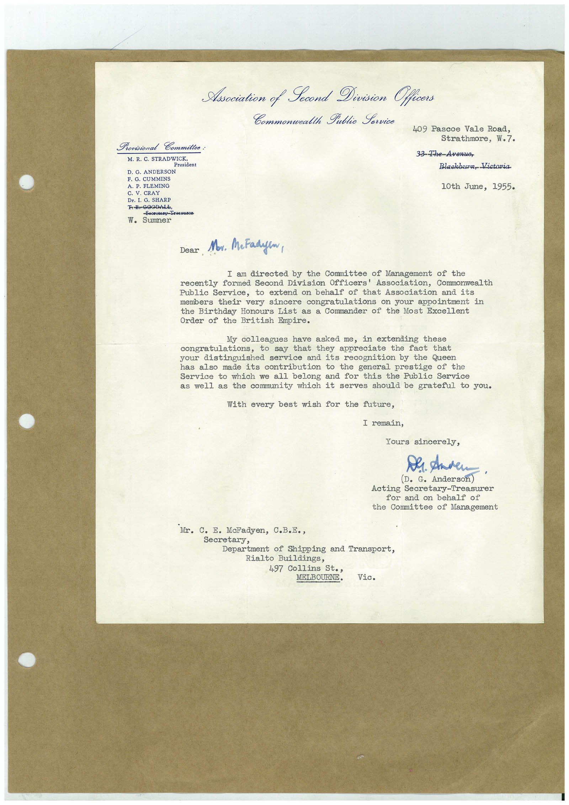

# Book 1 · scan 100

[Original scan](../../images/book-1/large/JPEG/BOOK1%20-%20101.jpg)

## Description

## Transcription

## Context

## Review notes

Compare the machine draft with the scan. Handwriting and names need human review.

## Artifacts

<!-- ARTIFACTS:START -->
Edit the artifacts field in this note’s frontmatter to change these records. This summary is generated.

### B01-S100-A01 — Letter — Book 1, scan 100

Types: Typed document, Letter

Scope: Whole scanned page; individual items can be split out during review.

Caption: Not mapped yet.

Caption source: Not recorded yet.

Caption status: unmapped
<!-- ARTIFACTS:END -->

## Machine transcription

<!-- OCR:START -->
Provisional Committee:
M. R. C. STRADWICK
resident
D. G. ANDERSON
F. G. CUMMINS
A. P. FLEMING
C. V. CRAY
Dr. I. G. SHARP
T-B-GOODALE,
-Seorotesy Treasures
W.
Sumner
Asociation of Second Division Officers
Commonwealth Public Service
409 Pascoe Vale Road,
Strathmore, W.7.
33 The-Avenue,
Blackburn, Victoria
10th June, 1955.
Dear
Mor. McFadyen,
I am directed by the Committee of Management of the
recently formed Second Division Officers' Association, Commonwealth
Public Service, to extend on behalf of that Association and its
members their very sincere congratulations on your appointment in
the Birthday Honours List as a Commander of the Most Excellent
Order of the British Empire.
My colleagues have asked me, in extending
these
congratulations, to say that they appreciate the fact that
your distinguished service and its recognition by the Queen
has also made its contribution to the general prestige of the
Service to which we all belong and for this the Public Service
as well as the community which it serves should be grateful to you.
With every best wish for the future,
I remain,
Yours sincerely,
Der. Anden
(D. G. Anderson) '
Acting Secretary-Treasurer
for and on behalf of
the Committee of Management
Mr. C. E. McFadyen, C.B.B.,
Secretpartment of Shipping and Transport,
Rialto Buildings,
497 Collins St.,
MELBOURNE.
Vic.
<!-- OCR:END -->
