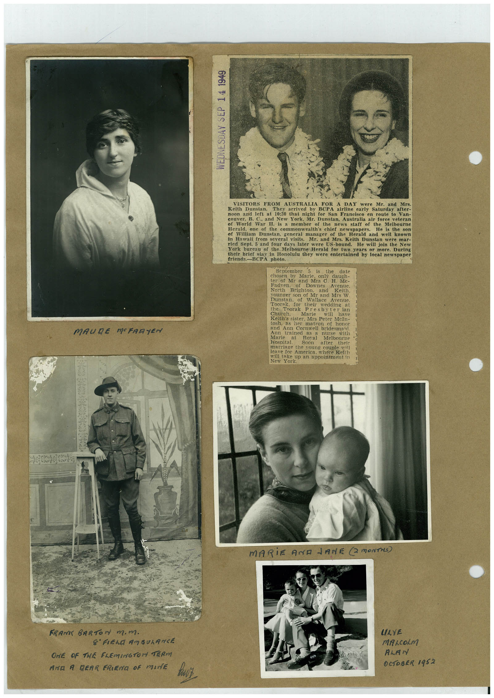

# Book 1 · scan 101

[Original scan](../../images/book-1/large/JPEG/BOOK1%20-%20102.jpg)

## Description

## Transcription

## Context

## Review notes

Compare the machine draft with the scan. Handwriting and names need human review.

## Artifacts

<!-- ARTIFACTS:START -->
Edit the artifacts field in this note’s frontmatter to change these records. This summary is generated.

### B01-S101-A01 — Newspaper clipping, Photo & Handwritten note — Book 1, scan 101

Types: Newspaper clipping, Photo, Handwritten note

Scope: Whole scanned page; individual items can be split out during review.

Caption: Not mapped yet.

Caption source: Not recorded yet.

Caption status: unmapped
<!-- ARTIFACTS:END -->

## Machine transcription

<!-- OCR:START -->
WEDNESDAY SEP 14 1949
MAURE MERRYEN
VISITORS FROM
AUSTRALIA
A DAY
Keith Dunstan.
They
arrived by
were
Mr. and Mrs.
BCPA airline early Saturday after-
noon and left at 10:30 that night for San Francisco en route to Van-
couver, B. C., and New York, Mr. Dunstan, Australia air force veteran
of World War I. is a member of the news staff of the Melbourne
Herald,
one
of the commonwealth's chief
newspapers.
He is the son
ef
William Dunstan, general manager of the Herald and well known
in
Hawaii from several visits.
Mr. and Mrs. Keith Dunstan were mar-
ried Sept. 5 and four days later were US-bound.
He will join the New
York bureau of the Melbourne Herald for two years or more. During
their brief stay in Honolulu they were entertained by local newspaper
friends.-BCPA photo.
September 5 is
chosen
by
the
date
Marie,
only
daugh-
ter of Mi and Mis C. H. Mc-
Native" Brish On.
Downes
Avenue.
North
and
Keith.
vounger son of Mr and Mrs W
Dunstan.
of
Wallace
Avenue.
Toorak,
for
their
wedding at
the hoorak
Presbyter ian
Church.
Marie
will
have
Keith's sister, Mrs Peter McIn-
tosh, as her matron of honor
and Ann Cornwell bridesmaid
Ann
trained
Marie
at
Hospital.
Roval
Melbourne
Soon
after
their
marriage the voung couple mill
leave for America, where Keith
will take up an appointment in
New York.
MARiE AND LANE @ MONTHS)
FRANK BARToN m.m.
8' FIEND AM SUARNCE
ONE OF THE FLEMINGTOM TERM
AND A REAR FRIENA OF MINE
LAYE
MALOLM
ALAN
OCTOBER 1952
<!-- OCR:END -->
