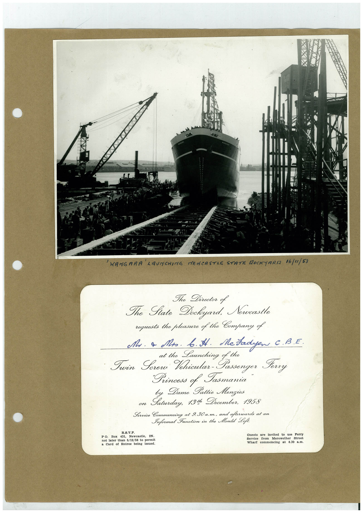

# Book 1 · scan 102

[Original scan](../../images/book-1/large/JPEG/BOOK1%20-%20103.jpg)

## Description

## Transcription

## Context

## Review notes

Compare the machine draft with the scan. Handwriting and names need human review.

## Artifacts

<!-- ARTIFACTS:START -->
Edit the artifacts field in this note’s frontmatter to change these records. This summary is generated.

### B01-S102-A01 — Photo & Invitation — Book 1, scan 102

Types: Photo, Invitation

Scope: Whole scanned page; individual items can be split out during review.

Caption: Not mapped yet.

Caption source: Not recorded yet.

Caption status: unmapped
<!-- ARTIFACTS:END -->

## Machine transcription

<!-- OCR:START -->
'WANGARA LAUNCHING NEWCASTLE STATE MOCKYARD
16/"1/53
The Director of
The Fate Dockeyard. Newcastle
requests the pleasure of the Company of
Mr. a Mos. b. I. McFadyen C. B.E.
Launching of the
Twin Serer Vehicular-Passenger Ferry
Princess of Jasmania
Dame
Pattie Menzies
Laterdug 730 Recordan 1958
R.S.V.P.
PO.
Box
431,
Newcastle,
not later than 5/12/58 to bermit
Card of Entree being
issued.
Guests are invited to use perts
Service from Merewether
Street
Wharf commencing at
8.30 8.11.
<!-- OCR:END -->
