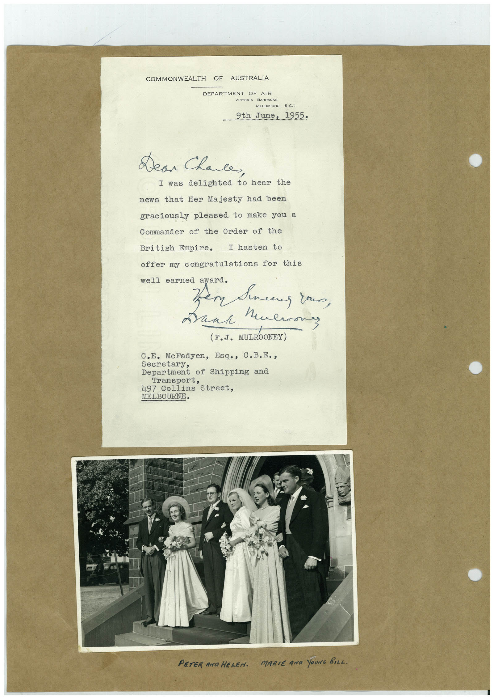

# Book 1 · scan 103

[Original scan](../../images/book-1/large/JPEG/BOOK1%20-%20104.jpg)

## Description

## Transcription

## Context

## Review notes

Compare the machine draft with the scan. Handwriting and names need human review.

## Artifacts

<!-- ARTIFACTS:START -->
Edit the artifacts field in this note’s frontmatter to change these records. This summary is generated.

### B01-S103-A01 — Letter, Photo & Handwritten note — Book 1, scan 103

Types: Typed document, Letter, Photo, Handwritten note

Scope: Whole scanned page; individual items can be split out during review.

Caption: Not mapped yet.

Caption source: Not recorded yet.

Caption status: unmapped
<!-- ARTIFACTS:END -->

## Machine transcription

<!-- OCR:START -->
COMMONWEALTH OF AUSTRALIA
DEPARTMENT OF AIR
VICTORIA BARRACKS
MELBOURNE, S.C.1
- 9th June, 1955.
Dear Chales,
I was delighted to hear the
news that Her Majesty had been
graciously pleased to make you a
Commander of the Order of the
British Empire. I hasten to
offer my congratulations for this
well earned award.
and Mulrones
(F.J. MULROONEY)
C.E. MeFadyen, Esq., C.B.E.,
Secretary,
Department of Shipping ano
Transport,
497 Collins Street,
MELBOURNE.
PETER AND HELEr.
MARIE ANa YoUNG BILL.
<!-- OCR:END -->
