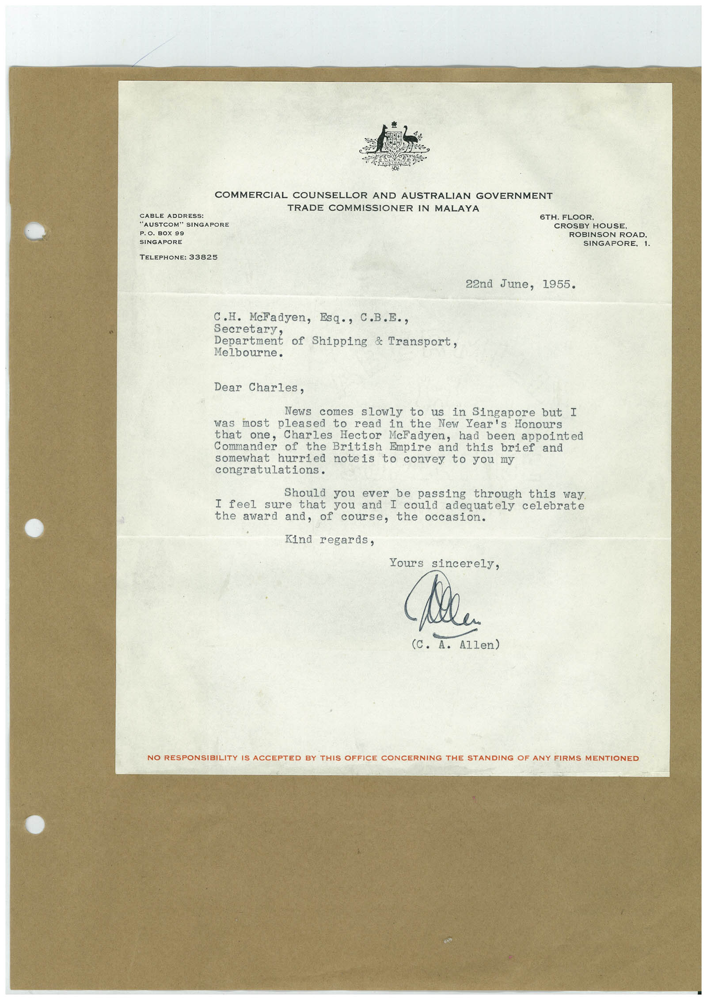

# Book 1 · scan 104

[Original scan](../../images/book-1/large/JPEG/BOOK1%20-%20105.jpg)

## Description

## Transcription

## Context

## Review notes

Compare the machine draft with the scan. Handwriting and names need human review.

## Artifacts

<!-- ARTIFACTS:START -->
Edit the artifacts field in this note’s frontmatter to change these records. This summary is generated.

### B01-S104-A01 — Letter — Book 1, scan 104

Types: Typed document, Letter

Scope: Whole scanned page; individual items can be split out during review.

Caption: Not mapped yet.

Caption source: Not recorded yet.

Caption status: unmapped
<!-- ARTIFACTS:END -->

## Machine transcription

<!-- OCR:START -->
COMMERCIAL COUNSELLOR AND AUSTRALIAN GOVERNMENT
TRADE COMMISSIONER IN MALAYA
CABLE ADDRESS:
"AUSTCOM" SINGAPORE
P. O. BOX 99
SINGAPORE
TELEPHONE: 33825
6TH. FLOOR,
CROSBY HOUSE
ROBINSON ROAD.
SINGAPORE, 1.
22nd June, 1955.
C.H. McFadyen, Esq., C.B.E.,
secretary.
Department of Shipping & Iransport,
Melbourne.
Dear Charles,
News
comes slowly to us in Singapore but I
was most pleased
to read in the New Year's Honours
that
one, Charles Hector McFadyen, had been appointed
Commander of the British Empire and this brief and
somewhat hurried
noteis to convey to you my
congratulations.
Should you ever be passing through this way
I feel
sure
that you and I could adequately celebrate
the award
and, of course, the occasion.
Kind regards,
Yours sincerely,
Mela
(C. A.
Allen)
NO RESPONSIBILITY IS ACCEPTED BY THIS OFFICE CONCERNING THE STANDING OF ANY FIRMS MENTIONED
<!-- OCR:END -->
