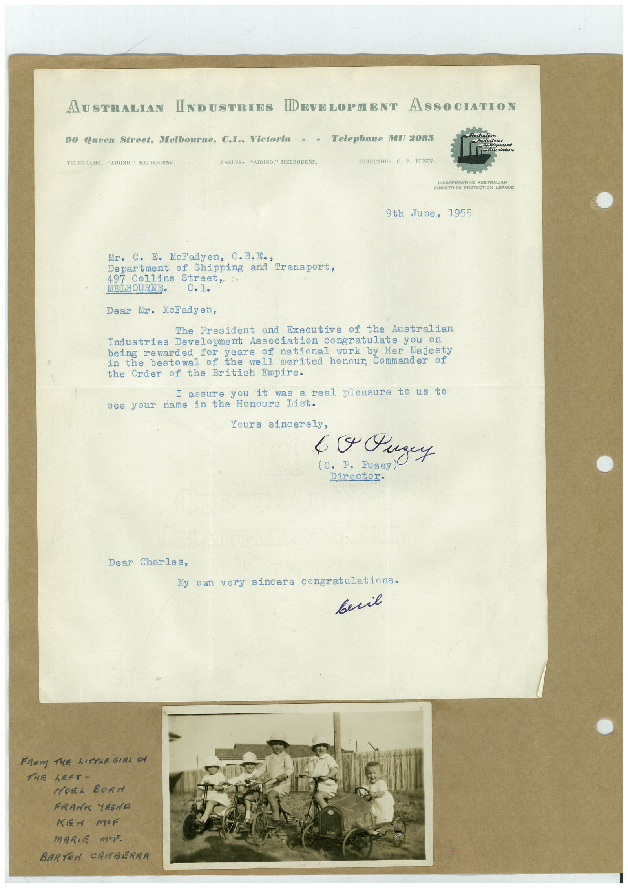

# Book 1 · scan 105

[Original scan](../../images/book-1/large/JPEG/BOOK1%20-%20106.jpg)

## Description

## Transcription

## Context

## Review notes

Compare the machine draft with the scan. Handwriting and names need human review.

## Artifacts

<!-- ARTIFACTS:START -->
Edit the artifacts field in this note’s frontmatter to change these records. This summary is generated.

### B01-S105-A01 — Letter, Photo & Handwritten note — Book 1, scan 105

Types: Typed document, Letter, Photo, Handwritten note

Scope: Whole scanned page; individual items can be split out during review.

Caption: Not mapped yet.

Caption source: Not recorded yet.

Caption status: unmapped
<!-- ARTIFACTS:END -->

## Machine transcription

<!-- OCR:START -->
AUSTRALIAN INDUSTEIES
DEVELOPMENT ASSOCIATION
90 Queen Street. Melbourne, C.I., Victoria - - Telephone MW 2085
TELECRAMS: "AIDIND." MELBOURNE.
CABLES: "AIDIND. MELBOURNE.
DIRECTOR: C. P. PUZEY.
SINCOBRARATING AUSTRALIAN
INDUSTRIES PROTECTION LEAGUE
9th
June, 1955
Mr. C. E. Ncladyen, C.B.Eo,
Department of Shipping and Transport,
497 Collins Street,
MELBOURNE•
Dear Mr. McFadyen,
The President and Executive of the Australian
Industries Development Association congratulate you on
being rewarded for years of national
work by Her Majesty
in the bestowal of the well merited honour, Commander of
the Order of the British Empire.
I assure you it was a real pleasure to us to
see your name in the Honours list.
Yours sincerely,
C. P. Fuzey
Director.
Dear Charles,
My own very sincere congratulations.
весів
FROM THE LITTLE GIRL ON
THE LEFT-
HOEL BORd
FRANK YEEND
KEN mEF
MARIE Mer.
BARTON CAMBERRA
<!-- OCR:END -->
