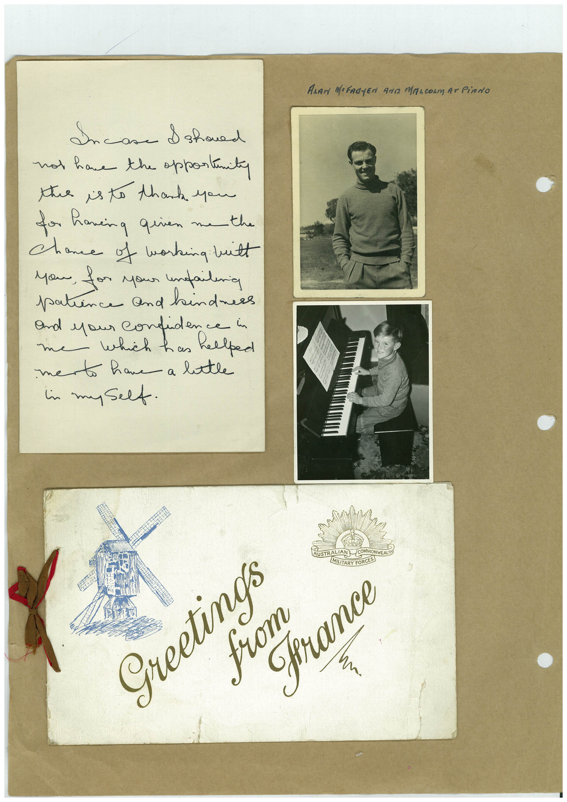

# Book 1 · scan 108

[Original scan](../../images/book-1/large/JPEG/BOOK1%20-%20109.jpg)

## Description

## Transcription

## Context

## Review notes

Compare the machine draft with the scan. Handwriting and names need human review.

## Artifacts

<!-- ARTIFACTS:START -->
Edit the artifacts field in this note’s frontmatter to change these records. This summary is generated.

### B01-S108-A01 — Photo, Letter, Greeting card & Handwritten note — Book 1, scan 108

Types: Photo, Letter, Greeting card, Handwritten note

Scope: Whole scanned page; individual items can be split out during review.

Caption: Not mapped yet.

Caption source: Not recorded yet.

Caption status: unmapped
<!-- ARTIFACTS:END -->

## Machine transcription

<!-- OCR:START -->
ANAN MeFRAYEN AND MALCOLM aT PiANO
Incase I shoued
not have the opportinity
the is to thank you
for having given me the
chance of working built
you, for your unfaileria
patience and hindnes
and you confide eped
mento have a latle
in myself.
Greetings
from
STRALIAN COMMONWEALT
(LITARY FORCES
France
<!-- OCR:END -->
