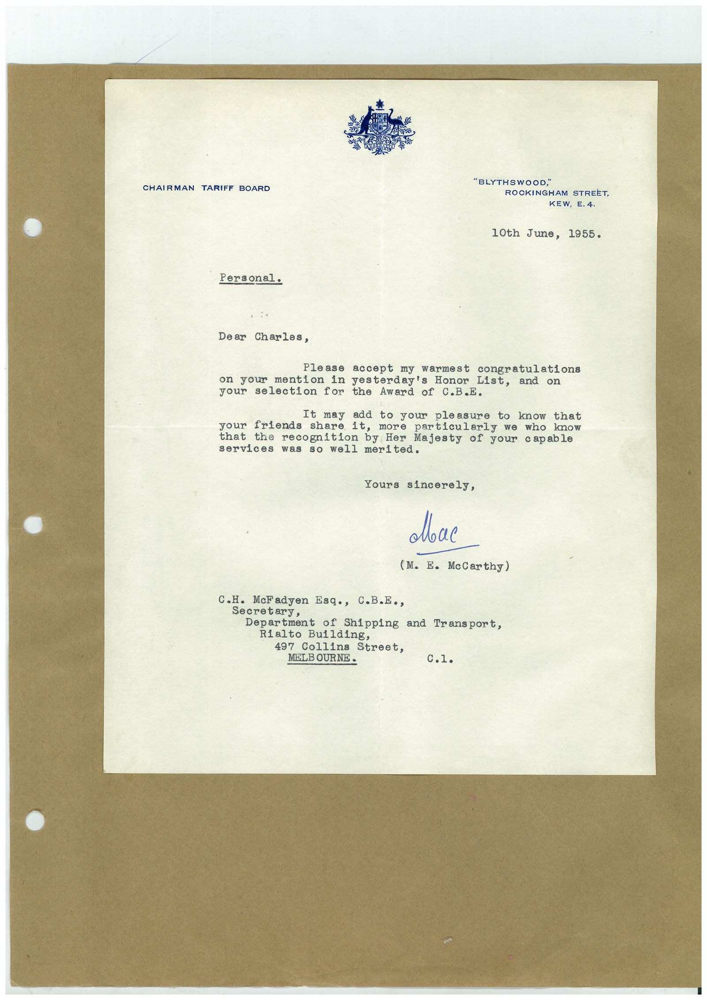

# Book 1 · scan 111

[Original scan](../../images/book-1/large/JPEG/BOOK1%20-%20112.jpg)

## Description

## Transcription

## Context

## Review notes

Compare the machine draft with the scan. Handwriting and names need human review.

## Artifacts

<!-- ARTIFACTS:START -->
Edit the artifacts field in this note’s frontmatter to change these records. This summary is generated.

### B01-S111-A01 — Letter — Book 1, scan 111

Types: Typed document, Letter

Scope: Whole scanned page; individual items can be split out during review.

Caption: Not mapped yet.

Caption source: Not recorded yet.

Caption status: unmapped
<!-- ARTIFACTS:END -->

## Machine transcription

<!-- OCR:START -->
CHAIRMAN
TARIFF BOARD
"BLYTHSWOOD,"
ROCKINGHAM STREET,
KEW, E. 4.
10th June, 1955.
Personal.
Dear Charles,
Please accept my warmest congratulations
on your mention
in yesterday's Honor List, and on
your
selection
for the Award of C.B.E.
your
It may add to your pleasure to know that
friends share it, more particularly we who know
that
recognition by Her Majesty of your capable
services
was so well merited.
Yours sincerely,
Лвас
(M. E. McCarthy)
C.H. McFadyen Esq., C.B.E.,
Secretary,
Department of Shipping and Transport,
Rialto Building,
497 Collins Street,
MELBOURNE.
<!-- OCR:END -->
