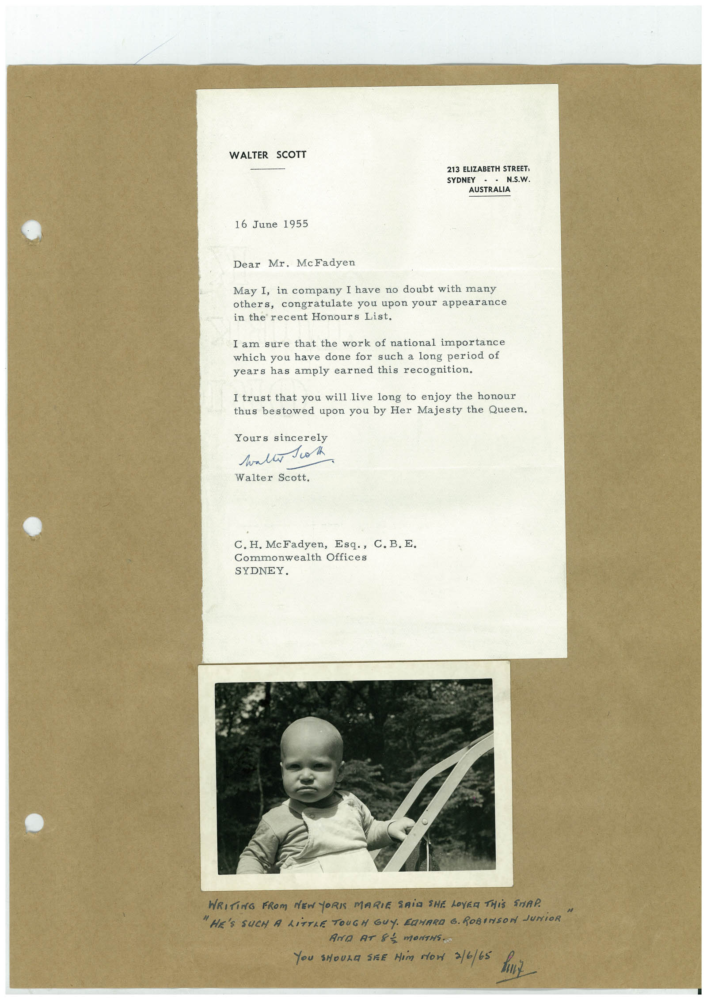

# Book 1 · scan 113

[Original scan](../../images/book-1/large/JPEG/BOOK1%20-%20114.jpg)

## Description

## Transcription

## Context

## Review notes

Compare the machine draft with the scan. Handwriting and names need human review.

## Artifacts

<!-- ARTIFACTS:START -->
Edit the artifacts field in this note’s frontmatter to change these records. This summary is generated.

### B01-S113-A01 — Letter & Photo — Book 1, scan 113

Types: Typed document, Letter, Photo

Scope: Whole scanned page; individual items can be split out during review.

Caption: Not mapped yet.

Caption source: Not recorded yet.

Caption status: unmapped
<!-- ARTIFACTS:END -->

## Machine transcription

<!-- OCR:START -->
WALTER SCOTT
213 ELIZABETH STREET,
SYDNEY
- - N.S.W.
AUSTRALIA
16 June 1955
Dear Mr. McFadyen
May I, in company I have no doubt with many
others, congratulate you upon your appearance
in the recent Honours List.
I am sure that the work of national importance
which you have done for such a long period of
years has amply earned this recognition.
I trust that you will live long to enjoy the honour
thus bestowed upon you by Her Majesty the Queen.
Yours sincerely
wallo ok
Walter Scott.
C. H. McFadyen, Esq., C. B.E.
Commonwealth Offices
SYDNEY.
WRITiNG FROM NEW YORIS MARIE SAiD SHE LOYER THiS STAP.
"HE'S SUCH A LiTTLE TOUGH GUY. EQHARD G. ROBINSON JUNiOR
AND AT 83 MONTHS.
You sHouza SiER Him Mon 3/6/65 hut
<!-- OCR:END -->
