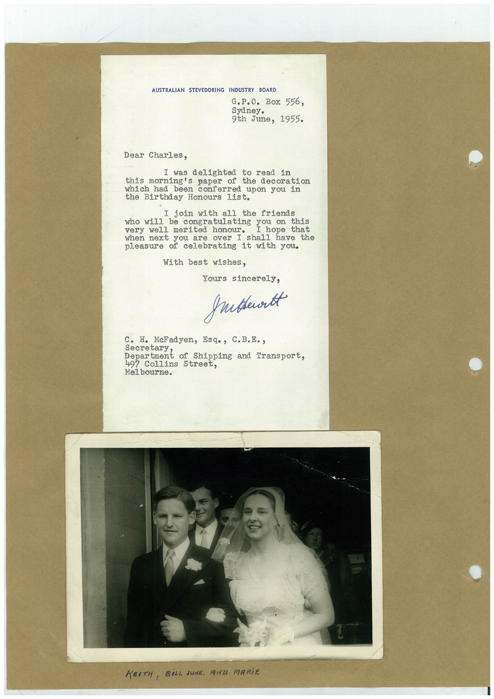

# Book 1 · scan 114

[Original scan](../../images/book-1/large/JPEG/BOOK1%20-%20115.jpg)

## Description

## Transcription

## Context

## Review notes

Compare the machine draft with the scan. Handwriting and names need human review.

## Artifacts

<!-- ARTIFACTS:START -->
Edit the artifacts field in this note’s frontmatter to change these records. This summary is generated.

### B01-S114-A01 — Letter & Photo — Book 1, scan 114

Types: Typed document, Letter, Photo

Scope: Whole scanned page; individual items can be split out during review.

Caption: Not mapped yet.

Caption source: Not recorded yet.

Caption status: unmapped
<!-- ARTIFACTS:END -->

## Machine transcription

<!-- OCR:START -->
AUSTRALIAN STEVEDORING INDUSTRY BOARD
G.P.O. Box 556,
Sydney.
9th June, 1955.
Dear Charles,
I was delighted to read in
this morning's paper of the decoration
which had been conferred upon you in
the Birthday Honours list.
I join with all the friends
ho will be congratulating you on this
very well merited honour.
I hope that
when next you are over I
shall have the
pleasure of celebrating it with you.
With best wishes,
Yours sincerely,
grubbertt
c. H. McFadyen, Esq., C.B.E.,
secretary.
Department of Shipping and Transport.
497 Collins Street,
Melbourne.
KEITH, BİLL SUNR. ANA MARiE
<!-- OCR:END -->
