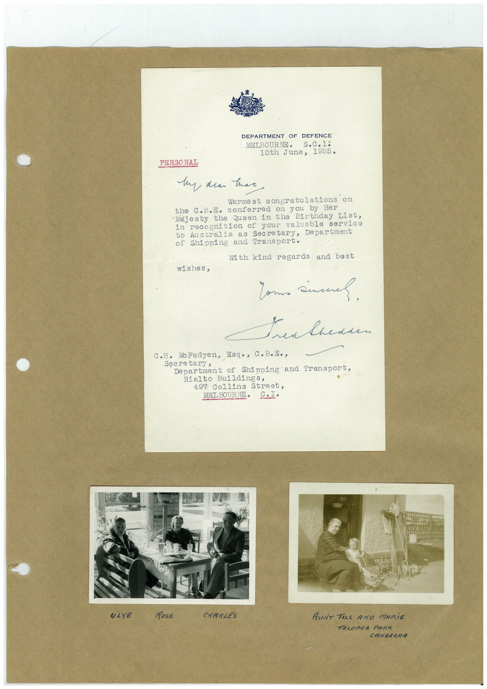

# Book 1 · scan 115

[Original scan](../../images/book-1/large/JPEG/BOOK1%20-%20116.jpg)

## Description

## Transcription

## Context

## Review notes

Compare the machine draft with the scan. Handwriting and names need human review.

## Artifacts

<!-- ARTIFACTS:START -->
Edit the artifacts field in this note’s frontmatter to change these records. This summary is generated.

### B01-S115-A01 — Letter, Photo & Handwritten note — Book 1, scan 115

Types: Typed document, Letter, Photo, Handwritten note

Scope: Whole scanned page; individual items can be split out during review.

Caption: Not mapped yet.

Caption source: Not recorded yet.

Caption status: unmapped
<!-- ARTIFACTS:END -->

## Machine transcription

<!-- OCR:START -->
DEPARTMENT OF DEFENCE
MELBOURNE•
s.c.1:
10th June, 1955.
PERSONAL
My dean her
Warmest congratulations
the c.B.E. conferred on you by Her
•Majesty
• the Queen in the Birthday List,
in recognition of your valuable service
to Australia as Secretary, Department
of Shipping and Transport.
With kind regards and best
wishes,
Tam sinch
C.H. MoFadyen, Esq•, C.B.E.,
Secretary,
Department of
Shipping and Transport,
Rialto Buildings,
497 Collins Street,
MEL BOURNE•
9.-•
ULYE
RosE
CHARIES
AUNT TELL AND MARiE
TELOPER PARK
CANBERRA
<!-- OCR:END -->
