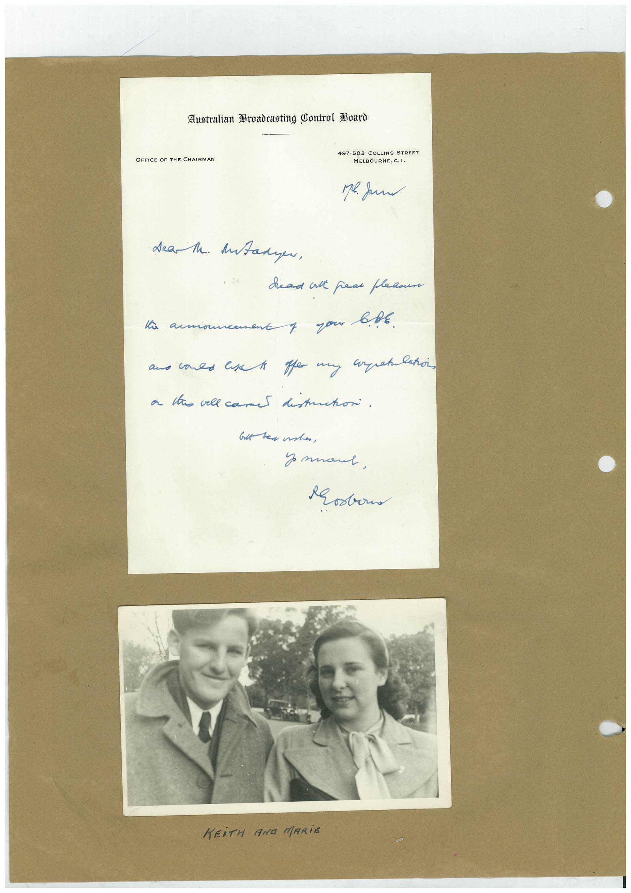

# Book 1 · scan 116

[Original scan](../../images/book-1/large/JPEG/BOOK1%20-%20117.jpg)

## Description

## Transcription

## Context

## Review notes

Compare the machine draft with the scan. Handwriting and names need human review.

## Artifacts

<!-- ARTIFACTS:START -->
Edit the artifacts field in this note’s frontmatter to change these records. This summary is generated.

### B01-S116-A01 — Letter, Photo & Handwritten note — Book 1, scan 116

Types: Letter, Photo, Handwritten note

Scope: Whole scanned page; individual items can be split out during review.

Caption: Not mapped yet.

Caption source: Not recorded yet.

Caption status: unmapped
<!-- ARTIFACTS:END -->

## Machine transcription

<!-- OCR:START -->
OFFICE OF THE CHAIRMAN
Australian Broadcasting Control Board
497-503 COLLINS STREET
MELBOURNE, C.
dea M. Antadyer,
dead ant fear pleasure
amou
f you bbt.
sper my atlako,
a las vell came distritori.
Poston
KEITH ANG MARiE
<!-- OCR:END -->
