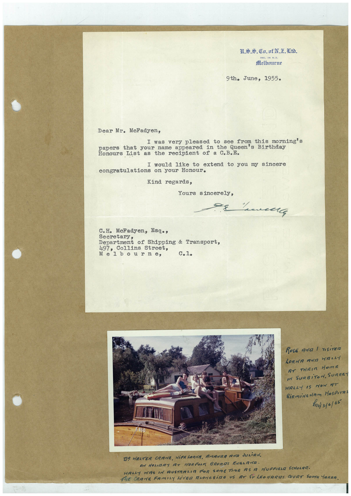

# Book 1 · scan 117

[Original scan](../../images/book-1/large/JPEG/BOOK1%20-%20118.jpg)

## Description

## Transcription

## Context

## Review notes

Compare the machine draft with the scan. Handwriting and names need human review.

## Artifacts

<!-- ARTIFACTS:START -->
Edit the artifacts field in this note’s frontmatter to change these records. This summary is generated.

### B01-S117-A01 — Letter, Photo & Handwritten note — Book 1, scan 117

Types: Typed document, Letter, Photo, Handwritten note

Scope: Whole scanned page; individual items can be split out during review.

Caption: Not mapped yet.

Caption source: Not recorded yet.

Caption status: unmapped
<!-- ARTIFACTS:END -->

## Machine transcription

<!-- OCR:START -->
ING. IN N.Z.
Melhmirne
9th. June, 1955.
Dear Mr. Mcfadyen,
I was very pleased to see from this morning's
papers that your name appeared
in the Queen's Birthday
Honours
List
the recipient of a C.B.E.
I would like to extend to you my sincere
congratulations on your Honour.
Kind regards,
Yours sincerely,
C.H. MeFadyen, Esq.,
secretary
epartment of Shipping & Iransport,
497,
Collins Street,
Melbourne,
C.1.
ROSE AND / VISiTER
LORMA AND HALAY
RT THEIR HOME
I SURBiTON, SURREY
WALLY IS NOW AT
hi 310/65
TR HALTER CRAME, WiFELORAR, AMANRA RUD JULiAN.
ON MONIARY AT NORFOLK BRORIS ENGLANA.
HALLY HAS IN AUSTRALIA FOR SOMETIME AS A MUFFIEL SCHOLAR.
THE CRANE FAMILY LiVED ALONGSiDE US AT STLEOMARIS COURT SOUTN TARRA.
<!-- OCR:END -->
