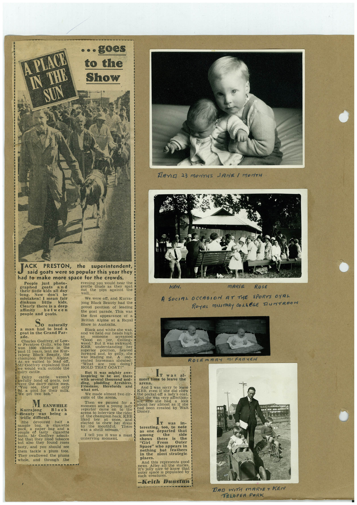

# Book 1 · scan 118

[Original scan](../../images/book-1/large/JPEG/BOOK1%20-%20119.jpg)

## Description

## Transcription

## Context

## Review notes

Compare the machine draft with the scan. Handwriting and names need human review.

## Artifacts

<!-- ARTIFACTS:START -->
Edit the artifacts field in this note’s frontmatter to change these records. This summary is generated.

### B01-S118-A01 — Newspaper clipping, Photo & Handwritten note — Book 1, scan 118

Types: Newspaper clipping, Photo, Handwritten note

Scope: Whole scanned page; individual items can be split out during review.

Caption: Not mapped yet.

Caption source: Not recorded yet.

Caption status: unmapped
<!-- ARTIFACTS:END -->

## Machine transcription

<!-- OCR:START -->
A PIACE.
IN
THE
SUN
• • • goes
to the
Show
DAVID 23 MONTHS JANE I MONTH
JACK
PRESTON,
the
superintendent,
said goats were so popular this year they
had to make more space for the crowds.
People
just
photo-
evening you would hear the
graphed
goats
and
thuds as ther
their little kids all day
the
spat
pips against
long.
Now
don't
be
wall.
mistaken! I mean fair
We were off, and Kurra-
dinkum
little
kids.
jong Black Beauty had the
Clearly there is a deep
proud position of leading
affinity
between
people and goats.
the goat parade. This was
the first appearance of a
So
British Alpine at a Royal
naturally
Show in Australia.
a man had to lead a
Black and white she was,
goat in the Grand Par-
and we held our heads high
ade.
Charles Godfrey, of Low-
as
SO COU
"Good
on
yer,
Colling-
er Ferntree Gully,
who has
wood." But it was awkward
1600
ribbons
in
the
lent me Kur-
superior
Black
Beauty.
position,
heaved
British
Alpine
forward
and,
by golly,
she
to lead
coated horseman shouted:
Mr Godfrey explained that
we would
walk outside the
"What
HOLD THAT GOAT
doing?
But it was
mighty
Dairy
cattle
weren't
oi goats,
JUL
I were the dairy cattle men.
"You
they
get
9d. a
pint for
only
their milk.
We Doo
inspiring to
be
out here
was
al-
with several thousand nod-
most time to leave the
ding,
plodding
Friesians.
Ayrshires,
arena.
Herefords
and
what net.
And I was sorry to leave
We made almost two cir-
KBB,
even she did chew
i the pocket off a lady's coat.
cuits of the arena.
But she was very affection-
MEANWHILE
Kurrajong
Beauty
was
Black
being a
trifle diffieult.
She
devoured
302.
sample
bag.
cigarette
couple paper
and
butts.
cigarette
Mr
Godfrey
admit-
ted that they liked tobacco
but also
they found roses
tasty, and you should see
them tackle a plum tree.
They swallowed the plums
and
through
the
Then we
paused for a i
ate ase see nad
moment and a young lady about her almost as it she
had been created by
dona be arterview bue nee
of the champion hack, KBE
liked
her
started to chew
once,
and
her
dress
There
was a shrill scream.
I tell you it was a most
unnerving moment.
Ir
in-
teresting,
too, to
as one
departed
note
among
the
that
Shows
there
"Girl
From
is
side
the
Outer
Space" whe appears in
nothing
but
feathers
most strategic
places.
And this represents good
3821S
stories,
outer
space is populated by
such creatures.
-Keith Dunstan
KEN.
MARiE
RosE
A SOCIAL OCCASION AT THE SPORTS OYAL
ROYAL MILITARY COLLEGE DUNTROON
ROSEMARY MOFARTEN
DAD WITH MARIE+ KEN
TELOPER PARK
<!-- OCR:END -->
