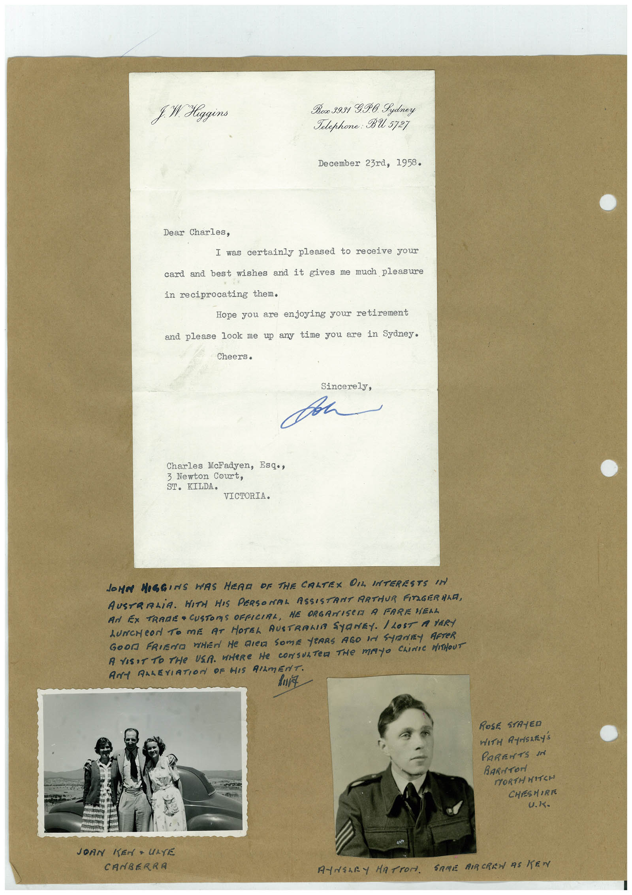

# Book 1 · scan 119

[Original scan](../../images/book-1/large/JPEG/BOOK1%20-%20120.jpg)

## Description

## Transcription

## Context

## Review notes

Compare the machine draft with the scan. Handwriting and names need human review.

## Artifacts

<!-- ARTIFACTS:START -->
Edit the artifacts field in this note’s frontmatter to change these records. This summary is generated.

### B01-S119-A01 — Letter, Photo & Handwritten note — Book 1, scan 119

Types: Typed document, Letter, Photo, Handwritten note

Scope: Whole scanned page; individual items can be split out during review.

Caption: Not mapped yet.

Caption source: Not recorded yet.

Caption status: unmapped
<!-- ARTIFACTS:END -->

## Machine transcription

<!-- OCR:START -->
f. M. Higgins
Box 3931 G.P.O. Lydney
Telephone: BU 5727
December 23rd, 1958.
Dear Charles,
I was certainly pleased to receive your
card and best wishes and it gives me
much pleasure
in reciprocating them.
Hope you are enjoying your retirement
and please look me up any time you are in Sydney.
Cheers.
Sincerely,
Charles McFadyen, Esqo,
3 Newton Court,
ST. KILDA• VICTORIA.
JONN MOGGINS WAS HEAR OF THE CALTEX OIL INTERESTS IN
AUSTRALiA. WITH HIS PERSONAL ASSISTANT ARTHUR FITZGERALD,
AN EX TRADE • CUSTOMS OFFICIAL, HE ORGANISED A FAREWELL
LUNCHeON TO ME AT HOTEL AUSTRALIA SYRNEY. / LOST A VERY
GOOM FRIEND WHEN HE RICE SOmE YEARS AGO IN SYRNEY AFTER
A VISIT TO THE USA. WHERE HE CONSULTED THe MAYO CLINIC HITHOUT
ANY AALEVIATION OF HIS RIMENT
ROSE STAYED
WITH ANSARY'S
PARENTS IN
BARITOri
NORTH WITCH
CHESHIRE
U.K.
JOAN
CANBERRA
ANNALRY HATTON. SAME BIRCREW AS KEN
<!-- OCR:END -->
