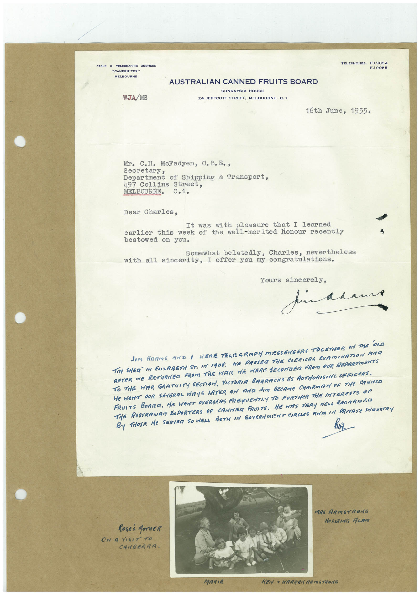

# Book 1 · scan 120

[Original scan](../../images/book-1/large/JPEG/BOOK1%20-%20121.jpg)

## Description

## Transcription

## Context

## Review notes

Compare the machine draft with the scan. Handwriting and names need human review.

## Artifacts

<!-- ARTIFACTS:START -->
Edit the artifacts field in this note’s frontmatter to change these records. This summary is generated.

### B01-S120-A01 — Letter, Photo & Handwritten note — Book 1, scan 120

Types: Typed document, Letter, Photo, Handwritten note

Scope: Whole scanned page; individual items can be split out during review.

Caption: Not mapped yet.

Caption source: Not recorded yet.

Caption status: unmapped
<!-- ARTIFACTS:END -->

## Machine transcription

<!-- OCR:START -->
TELEPHONES:
CABLE &
TELEGRAPHIC ADDRESS
"CANFRUITEX"
MELBOURNE
FJ 9055
WJA/MS
AUSTRALIAN CANNED FRUITS BOARD
SUNRAYSIA HOUSE
24 JEFFCOTT STREET,
MELBOURNE, C.1
16th June, 1955.
Mr. C.H. MeFadyen, C. B.E.,
secretary
Department of Shipping & Transport,
497 Collins Street,
MELBOURNE.
c.1.
Dear Charles,
It was with pleasure that I learned
earlier this week of the well-merited Honour recently
bestowed on you.
Somewhat belatedly, Charles, nevertheless
with all sincerity, I offer you my congratulations.
Yours sincerely,
pin adam
dom ARAmS AND I WERE TELEGRAPH MISSENGERS TOGETHER IN THE OLD
TEN SHER" IN ENZABETH ST. IN 1908. WE PASSER THE CHERICAL EXAMINATION AND
AFTER ME RETURNER FROM THE WAR WE WERE SECONDER FROM OUR RRPARTMENTS
TO THE WAR GRATUITY SECTION, VICTORIA BARRACKS AS AUTHORISING OFFICERS.
HE WENT OUR SEVERAL WAYS LATER ON AND dIM BECAMe CHAIRMAN OF THe CANNER
FRUITS BOARA. HE WENT OVERSEAS FREQUENTLY TO FURTHER THE INTERESTS OF
TiE RUSTRAMAN EXPORTERS OF CANNAM FRUITS. HE WAS VERY NELL REGARAñO
By THOSE He SERVEA SO WELL BOTH IN GOYERNmENT CIRCLeS ROTA IN PRIVATe INDUSTRY
MRS ARMSTRONG
ROSES MOTHER
ON A VISIT TO
CANBERRA.
MARIE
KENY " HARREN ARMSTRONG
<!-- OCR:END -->
