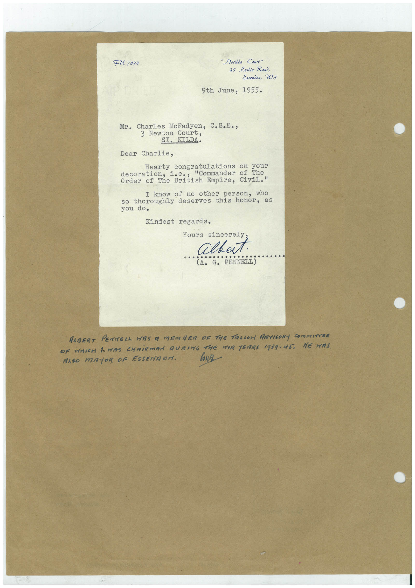

# Book 1 · scan 121

[Original scan](../../images/book-1/large/JPEG/BOOK1%20-%20122.jpg)

## Description

## Transcription

## Context

## Review notes

Compare the machine draft with the scan. Handwriting and names need human review.

## Artifacts

<!-- ARTIFACTS:START -->
Edit the artifacts field in this note’s frontmatter to change these records. This summary is generated.

### B01-S121-A01 — Letter — Book 1, scan 121

Types: Typed document, Letter

Scope: Whole scanned page; individual items can be split out during review.

Caption: Not mapped yet.

Caption source: Not recorded yet.

Caption status: unmapped
<!-- ARTIFACTS:END -->

## Machine transcription

<!-- OCR:START -->
FU 7834
"Nosilla Court"
35 Leslie Road,
Essendon, 20.5
9th June, 1955.
Mr. Charles MeFadyen, C.B.E.,
3 Newton Court,
ST. KILDA.
Dear Charlie,
Hearty congratulations on your
"Commander
of The
dedor of the British Empire, Civil"
I know of no other person, who
so thoroughly deserves this honor, as
you do.
Kindest regards.
Yours sincerely
albut.
PENNELL)
ARBERT PENNELL WAS A MEMBER OF THE TARLOH ARTIGORY COmmITTER
OF WHICH AWAS CHAIRMAN DURING THE MOR YEARS 1939-45. HE HAS
ALSO MAYOR OF ESSENTOr.
howa
<!-- OCR:END -->
