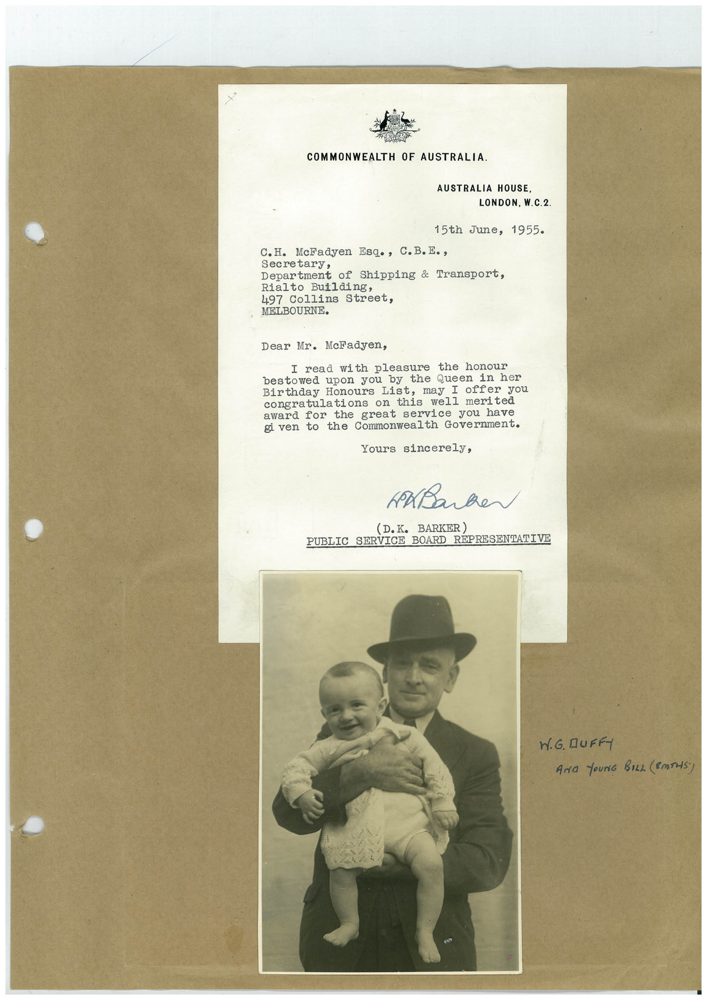

# Book 1 · scan 122

[Original scan](../../images/book-1/large/JPEG/BOOK1%20-%20123.jpg)

## Description

## Transcription

## Context

## Review notes

Compare the machine draft with the scan. Handwriting and names need human review.

## Artifacts

<!-- ARTIFACTS:START -->
Edit the artifacts field in this note’s frontmatter to change these records. This summary is generated.

### B01-S122-A01 — Letter, Photo & Handwritten note — Book 1, scan 122

Types: Typed document, Letter, Photo, Handwritten note

Scope: Whole scanned page; individual items can be split out during review.

Caption: Not mapped yet.

Caption source: Not recorded yet.

Caption status: unmapped
<!-- ARTIFACTS:END -->

## Machine transcription

<!-- OCR:START -->
COMMONWEALTH OF AUSTRALIA.
AUSTRALIA HOUSE,
LONDON, W.C.2
15th June, 1955.
C.H. McFadyen Esq., C.B.E.,
Secretary,
Department of Shipping & Transport,
Rialto Building,
497 Collins Street,
MELBOURNE.
Dear Mr. McFadyen,
I read with pleasure
bestowed upon you by
• the Queen in her
Birthday Honours List, may I offer you
congratulations on this well merited
award for the great service you have
given to the Commonwealth Government.
Yours sincerely,
D.K. BARKER)
PUBLIC SERVICE BOARD REPRESENTATIVE
N.G. DUFFY
AND fOUNG BILL (SMTHS)
<!-- OCR:END -->
